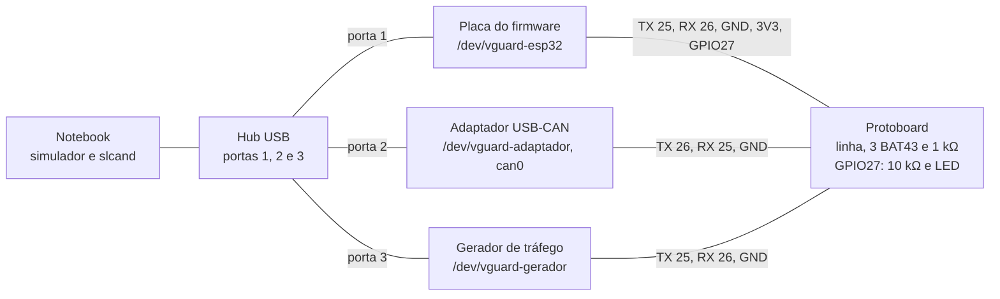
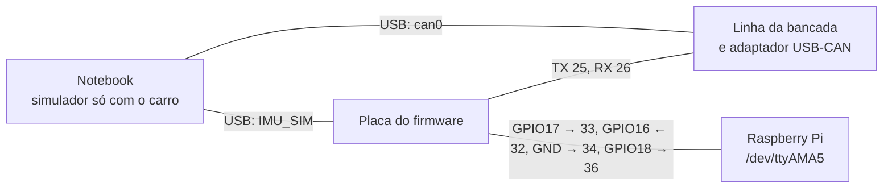

# Bancada e fiação

As peças, os pinos e os fios da bancada: as três placas ESP32 da fase 2, o laço da UART5 da fase 3, os fios até a Pi na fase 4 e a sessão com transceptor antes do carro. Especificação fechada no [ticket #11](https://github.com/V-guard-org/firmware_telemetria/issues/11) em 15/10/2026.

A base são as pesquisas:
- [#2](https://github.com/V-guard-org/firmware_telemetria/issues/2): barramento de bancada sem transceptor (BAT43 e 1 kΩ);
- [#3](https://github.com/V-guard-org/firmware_telemetria/issues/3): o adaptador USB-CAN (Doggie ou ponte própria, `slcand`);
- [#4](https://github.com/V-guard-org/firmware_telemetria/issues/4): o transceptor em modo silencioso e os pinos seguros no boot;
- [#5](https://github.com/V-guard-org/firmware_telemetria/issues/5): as UARTs da Pi 4 e o 5 V.

Os testes que usam esta montagem estão no [`TESTES.md`](TESTES.md). Os termos seguem o [`CONTEXT.md`](../CONTEXT.md).

Os desenhos de cada montagem, em 9 folhas, estão em [`esquematico/esquematico.html`](esquematico/esquematico.html): abra o arquivo no navegador. A página sai do `esquematico/gen.py`; quem mudar a fiação aqui atualiza o `page.html` ou o desenho e roda `python3 docs/esquematico/gen.py`. Se o desenho e este documento discordarem, vale este documento.

## Resumo

- **Três placas numa linha só,** com um BAT43 por placa e um *pull-up* de 1 kΩ para o 3,3 V da placa do firmware, que é a única que nunca sai da linha (§3).
- **O adaptador fica sempre em TX = GPIO26 e RX = GPIO25,** os pinos do Doggie. Se ele falhar, a ponte própria usa os mesmos pinos, e a fiação não muda (§2).
- **GPIO27 na bancada:** um resistor de 10 kΩ para o 3,3 V faz o papel do resistor do transceptor, e o LED de liberação acende quando o firmware libera o transceptor (§4).
- **Nomes fixos das portas** no notebook, pela porta do hub: `/dev/vguard-esp32`, `/dev/vguard-adaptador` e `/dev/vguard-gerador` (§5).
- **Fase 4:** os fios da Pi saem da UART2 do ESP32 (TX = GPIO17, RX = GPIO16), com 1 kΩ em série em cada fio. O fio do horário vai do GPIO18 do ESP32 ao GPIO16 da Pi, no pino 36 (§7).
- **Uma fonte só:** com o USB ligado, o fio de 5 V da Pi fica desligado (§7.2).
- **IMU real:** I²C no GPIO21 (SDA) e GPIO22 (SCL); o GPIO34 fica reservado para o sinal de dado pronto (§8).
- **Sessão com transceptor:** os transceptores são o TJA1050 dos módulos MCP2515 + TJA1050 já comprados, com o MCP2515 tirado da placa ([ADR-0010](adr/0010-do-modulo-can-so-o-transceptor.md)). Com os módulos preparados, uma sessão curta prova o modo silencioso e o jumper do GPIO27 antes do carro (§9).

## 1. Peças

Nada desta lista foi conferido ainda. A coluna "Na mão" fica para quem montar.

| Peça | Qtd | Para quê | Na mão |
|---|---|---|---|
| Placa ESP32 com módulo **WROOM-32** | 3, mais 1 de reserva | Firmware, adaptador e gerador. O nome do módulo está na tampa metálica. Com WROVER, ver §7.1 | a conferir |
| Diodo **BAT43** (ou BAT42) | 3, mais 2 de reserva | Um por placa na linha. Na falta, 1N4148 com *pull-up* de 2,2 kΩ. **Não usar 1N5817** (#2) | a conferir |
| Resistor de 1 kΩ | 6 | *Pull-up* da linha, LED e os 3 fios de sinal da fase 4 | a conferir |
| Resistor de 10 kΩ | 1 | *Pull-up* do GPIO27 | a conferir |
| LED (de qualquer cor) | 1 | Mostra o transceptor liberado | a conferir |
| Protoboard pequena (400 furos) | 1 | A linha, os diodos e os resistores | a conferir |
| Jumpers de 10 cm (macho-fêmea e macho-macho) | ~20 | Das placas à protoboard | a conferir |
| Hub USB de 4 portas | 1 | As três placas no mesmo hub, com as portas etiquetadas (§5) | a conferir |
| Fusível rearmável (PTC) de 0,5 A | 1 | No fio de 5 V da Pi, na fase 4 (#5) | a conferir |
| **Módulo MCP2515 + TJA1050**, do qual só o TJA1050 é usado ([ADR-0010](adr/0010-do-modulo-can-so-o-transceptor.md)) | 3 | Carro, adaptador (bancada e testemunha no carro) e reserva. Dois deles vão para a sessão do §9 | comprados, a caminho |
| Resistor de 10 kΩ, para os módulos | 9 | Em cada módulo: o *pull-up* do TXD, o do S e a metade de cima do divisor do RXD (§9.2) | a conferir |
| Resistor de 20 kΩ | 3 | A metade de baixo do divisor do RXD, um por módulo (§9.2) | a conferir |
| Jumper de 2 pinos | 2 | JP1 na placa do firmware e JP2 no adaptador (§9) | a conferir |
| Resistor de 120 Ω | 2 | Só se faltar o jumper J1 de terminação do módulo | a conferir |
| Ferro de solda de ponta fina | 1 | Preparar os módulos (§9.1) | a comprar |
| Par trançado, ~50 cm | 1 | CANH e CANL na sessão do §9 | a conferir |

## 2. Pinos do ESP32

### 2.1 Placa do firmware

| GPIO | Função | Liga em | Fase |
|---|---|---|---|
| 1 e 3 (UART0) | O USB | Notebook. Na fase 2 leva o protocolo; na fase 4, só a IMU_SIM ([ADR-0009](adr/0009-imu-sim-pelo-usb-na-fase-4.md)) | 2 e 4 |
| 16 (RX2) | RX da UART2 | Pino 32 da Pi (TX), por 1 kΩ | 4 |
| 17 (TX2) | TX da UART2 | Pino 33 da Pi (RX), por 1 kΩ | 4 |
| 18 | Pulso do horário, só no build de teste | Pino 36 da Pi (GPIO16), por 1 kΩ | 4 |
| 21 | SDA da IMU | IMU real | quando chegar |
| 22 | SCL da IMU | IMU real | quando chegar |
| 25 | TX do TWAI | Catodo do diodo dela; TXD do transceptor no §9 | 2 em diante |
| 26 | RX do TWAI e contador de pulsos (PCNT) | Linha; RXD do transceptor no §9, pelo divisor de 10 kΩ e 20 kΩ | 2 em diante |
| 27 | Trava do transceptor | 10 kΩ e LED na protoboard (§4); pino S pelo JP1 no §9 | 2 em diante |
| 34 | Reservado: dado pronto (INT) da IMU | Nada, por enquanto | — |
| 3V3 | 3,3 V | *Pull-up* da linha, do GPIO27 e LED; IMU | 2 em diante |
| 5V (ou VIN) | 5 V | Fio de 5 V da Pi, **só sem o USB** (§7.2). Com o USB, alimenta o VCC do módulo CAN no §9 | 2 (§9) e 4 |
| GND | — | Trilha GND da protoboard; pino 34 da Pi | todas |

**Pinos que não servem** ([pesquisa do #4](https://github.com/V-guard-org/firmware_telemetria/issues/4)): 0, 2, 5, 12 e 15 decidem o modo de boot; 6 a 11 são da memória flash; 34 a 39 só servem como entrada. Na placa, os pinos às vezes aparecem como "D25" ou "IO25".

### 2.2 Adaptador USB-CAN e gerador de tráfego

| Placa | TX do TWAI | RX do TWAI | Outros pinos |
|---|---|---|---|
| Adaptador USB-CAN | **GPIO26** | **GPIO25** | Só o USB (UART0) e o GND |
| Gerador de tráfego | GPIO25 | GPIO26 | Só o USB (UART0) e o GND |

- **O adaptador é invertido de propósito.** São os pinos do Doggie ([#3](https://github.com/V-guard-org/firmware_telemetria/issues/3)), e mudá-los exigiria recompilar o Doggie, que é escrito em Rust. Se o Doggie falhar e escrevermos a ponte própria (`tools/adaptador-slcan/`), ela usa estes mesmos pinos. Assim a placa tem uma fiação só, e uma etiqueta "TX 26 · RX 25" nela evita o engano.
- **O GPIO15 do adaptador fica solto.** Ligá-lo ao GND calaria o texto que a placa imprime ao ligar, mas, pelo `slcand`, o kernel só conta essas linhas como erro e segue. Isso só faria falta no `slcan` direto do python-can, que é a via reserva.

## 3. Fase 2: o barramento de bancada

### 3.1 Desenho



O barramento, em detalhe. Cada placa liga o TX por um diodo e o RX direto na linha, e assim cada uma lê os próprios bits, como o controlador exige ([#2](https://github.com/V-guard-org/firmware_telemetria/issues/2)). O TX e o RX nunca se cruzam entre as placas.

```
                3V3 (da placa do firmware)
                  │
                 ┌┴┐
                 │ │ R1 = 1 kΩ
                 └┬┘
                  │
 LINHA ●──────●───●─────────●──────●──────────●──────●─────────● ponto "linha presa"
       │      │             │      │          │      │
       │      ▼ D1 BAT43    │      ▼ D2       │      ▼ D3        anodo na linha,
       │      ┬ (faixa)     │      ┬          │      ┬           faixa (catodo) no TX
       │      │             │      │          │      │
    GPIO26  GPIO25       GPIO25  GPIO26    GPIO26  GPIO25
      RX      TX           RX      TX        RX      TX
    ┌───────────────┐    ┌───────────────┐   ┌───────────────┐
    │   FIRMWARE    │    │   ADAPTADOR   │   │    GERADOR    │
    └───────┬───────┘    └───────┬───────┘   └───────┬───────┘
           GND ─────────────────GND────────────────GND
```

| TX das placas | Linha | O que acontece |
|---|---|---|
| Todos em 1 (recessivo) | cerca de 3,3 V | Os diodos ficam bloqueados, e o R1 segura a linha em 1 |
| Algum em 0 (dominante) | cerca de 0,45 V | O diodo daquela placa conduz e puxa a linha |

### 3.2 A protoboard

Use as trilhas de cima para o 3V3 e o GND, e as de baixo para a LINHA e o GND. Ligue os dois GND entre si.

| Trilha ou coluna | O que liga |
|---|---|
| Trilha **3V3** | Um fio do 3V3 da placa do firmware. Nenhuma outra placa liga o 3V3 |
| Trilhas **GND** | Um fio do GND de cada placa |
| Trilha **LINHA** | O RX das três placas, o anodo dos três diodos, o R1 até a trilha 3V3 e o ponto "linha presa" |
| Uma coluna por placa | A faixa (catodo) do diodo daquela placa e o fio do TX dela |
| Coluna do GPIO27 | O fio do GPIO27, o resistor de 10 kΩ até a 3V3 e o LED (§4) |
| Coluna da fase 4 | Os três resistores de 1 kΩ dos fios até a Pi (§7) |

- **Fios de até 10 cm** entre cada placa e a protoboard. A subida da linha (até 300 ns) se confere no osciloscópio; se passar disso, o primeiro passo é encurtar os fios ([#2](https://github.com/V-guard-org/firmware_telemetria/issues/2)).
- **Ponto "linha presa":** um jumper preso na trilha GND, com a outra ponta solta e marcada. Para o teste da linha presa ([`TESTES.md` §10.3](TESTES.md)), essa ponta vai na trilha LINHA. É seguro: passam 3,3 mA pelo R1, e os diodos ficam reversos.
- **Etiquetas** nas três placas (firmware, adaptador "TX 26 · RX 25" e gerador) e nas portas do hub.

### 3.3 Regras de montagem

1. Monte com tudo desligado e ligue o GND primeiro.
2. As três placas ficam no mesmo hub. Uma placa só fica na linha enquanto estiver alimentada: uma placa sem energia puxa a linha pelas proteções dos pinos e pode prendê-la ([#2](https://github.com/V-guard-org/firmware_telemetria/issues/2)).
3. **Tirar uma placa da linha** é tirar o diodo dela da protoboard e o fio do RX dela da trilha LINHA. A placa continua no USB. Nos testes do [`TESTES.md` §10.3](TESTES.md), "gerador desligado" quer dizer gerador fora da linha.
4. Antes de tirar o USB de uma placa, tire-a da linha.
5. **A placa do firmware nunca sai da linha:** é ela que alimenta o R1. No teste "sem ACK", saem o adaptador e o gerador, e o firmware fica sozinho com o *pull-up*.
6. Antes do primeiro teste, meça a linha parada com o multímetro: deve dar cerca de 3,3 V.

O aceite da bancada (linha parada, nível baixo, subida e 30 min sem erro) está no [`TESTES.md` §10.2](TESTES.md).

## 4. O GPIO27 na bancada

O firmware deixa o GPIO27 em 1 soltando o pino: ele é uma saída *open-drain*, que só sabe puxar para 0 ([`MAQUINAS-DE-ESTADO.md` §1](MAQUINAS-DE-ESTADO.md)). Quem segura o 1 é o resistor de 10 kΩ do pino S do transceptor. Na bancada de diodos não há transceptor, então sem um resistor o pino ficaria solto, e o osciloscópio não conseguiria provar que ele "nunca foi a 0" no boot e depois de uma pane ([`TESTES.md` §10.4](TESTES.md)).

```
   3V3 ──┬──────────────┐
         │              │
       [10 kΩ]        [1 kΩ]
         │              │
         │             LED ▼   (anodo em cima)
         │              │
GPIO27 ──┴──────────────┘
```

| GPIO27 | Tensão | LED | Significa |
|---|---|---|---|
| Solto (reset, boot, "1") | 3,3 V | Apagado | Transceptor silencioso |
| 0 | 0 V | Aceso | Transceptor liberado |

O LED de liberação mostra, em todos os testes da bancada, quando o ESP32 pode falar no CAN. Exemplo: no roteiro "Pi ausente", o LED apaga até 3 s depois do último PING, e dá para ver isso sem o osciloscópio.

## 5. As portas no notebook

Com três placas no USB, o Linux as chama de `/dev/ttyUSB0`, `1` e `2` na ordem em que foram ligadas. Basta ligar o gerador primeiro, ou tirar e pôr o USB do adaptador (um dos aceites do #3), para o simulador abrir a placa errada. Uma regra do udev dá a cada placa um nome fixo pela porta física do hub. Ela funciona com qualquer placa, mesmo as que vêm todas com o mesmo número de série.

| Porta do hub | Placa | Nome fixo | Quem abre |
|---|---|---|---|
| 1 | Firmware | `/dev/vguard-esp32` | O simulador (`--porta`) |
| 2 | Adaptador USB-CAN | `/dev/vguard-adaptador` | O `slcand`, que cria o `can0` |
| 3 | Gerador de tráfego | `/dev/vguard-gerador` | O monitor serial, para ler os contadores |

**Preparar o notebook** (uma vez):

```
sudo usermod -aG dialout $USER     # abrir as portas sem sudo; vale depois de sair e entrar de novo
sudo apt install can-utils         # slcand, candump, cansend, cangen
```

**Criar a regra:**
1. Ligue o hub sempre na mesma porta do notebook.
2. Ponha uma placa na porta 1 do hub e anote o caminho: `udevadm info -q property -n /dev/ttyUSB0 | grep '^ID_PATH='`. Repita nas portas 2 e 3.
3. Crie o `/etc/udev/rules.d/99-vguard.rules` com os três caminhos:

```
SUBSYSTEM=="tty", ENV{ID_PATH}=="<caminho da porta 1>", SYMLINK+="vguard-esp32", ENV{ID_MM_DEVICE_IGNORE}="1"
SUBSYSTEM=="tty", ENV{ID_PATH}=="<caminho da porta 2>", SYMLINK+="vguard-adaptador", ENV{ID_MM_DEVICE_IGNORE}="1"
SUBSYSTEM=="tty", ENV{ID_PATH}=="<caminho da porta 3>", SYMLINK+="vguard-gerador", ENV{ID_MM_DEVICE_IGNORE}="1"
```

4. `sudo udevadm control --reload-rules && sudo udevadm trigger --subsystem-match=tty`, e confira com `ls -l /dev/vguard-*`.

O `ID_MM_DEVICE_IGNORE` afasta o ModemManager, que está ativo no notebook e poderia abrir as portas para procurar um modem, mexendo no DTR e no RTS, que reiniciam a placa.

**Subir o `can0`** (roteiro do [#3](https://github.com/V-guard-org/firmware_telemetria/issues/3)):

```
sudo slcand -S 115200 /dev/vguard-adaptador can0
sleep 2                                            # abrir a porta pode reiniciar o adaptador
sudo ip link set can0 type can bitrate 500000
sudo ip link set can0 up
```

Nunca ligue o controle de fluxo (RTS/CTS): na placa, o RTS é o fio de reinício.

## 6. Fase 3: o laço da UART5

Antes de ligar o ESP32, um jumper do pino 32 (TX) ao pino 33 (RX) da Pi prova o `dtoverlay=uart5` e a velocidade, com `python3 host/link_test.py --laco --porta /dev/ttyAMA5` ([`TESTES.md` §11](TESTES.md)). A configuração da Pi (`config.txt`, console serial desligado) está na [pesquisa do #5](https://github.com/V-guard-org/firmware_telemetria/issues/5).

Tire o jumper antes de ligar o ESP32.

## 7. Fase 4: os fios até a Pi

### 7.1 Os fios

| Fio | ESP32 | No meio | Pi | Observação |
|---|---|---|---|---|
| TX do ESP32 | GPIO17 (TX2) | 1 kΩ | Pino 33 (GPIO13, RX da UART5) | `/dev/ttyAMA5` |
| RX do ESP32 | GPIO16 (RX2) | 1 kΩ | Pino 32 (GPIO12, TX da UART5) | |
| GND | GND | — | Pino 34 | |
| Pulso do horário | GPIO18 | 1 kΩ | Pino 36 (GPIO16) | Só no build de teste (§7.3) |
| 5 V | 5V (ou VIN) | PTC de 0,5 A | Pino 2 ou 4 | **Só sem o USB** (§7.2); num conector separado, com etiqueta |



- **UART2, não a UART0.** A UART0 é o USB, que na fase 4 leva a IMU_SIM do notebook ([ADR-0009](adr/0009-imu-sim-pelo-usb-na-fase-4.md)). Os GPIO16 e GPIO17 são os pinos de fábrica da UART2 e vêm marcados RX2 e TX2 na placa.
- **Se as placas forem WROVER:** no WROVER, os GPIO16 e GPIO17 são da memória extra (PSRAM). Nesse caso, a UART2 vai para o GPIO33 (TX) e o GPIO32 (RX), também livres no boot. Para o firmware, é só uma constante.
- **Os pinos 32, 33, 34 e 36 da Pi ficam juntos** no conector, então os quatro fios de sinal formam um cabo só. O fio de 5 V é separado.
- Os três resistores de 1 kΩ ficam na coluna da fase 4 da protoboard, perto do ESP32 (§3.2). A 460800 baud, ou mesmo a 1 Mbaud, eles não atrapalham o sinal.
- No carro, a ligação é do T19 (§10).

### 7.2 Alimentação: uma fonte só

A Espressif diz que a placa aceita uma única fonte: USB, pino de 5 V ou pino de 3,3 V. Duas fontes ligadas juntas podem estragar a placa, a porta USB do notebook ou a fonte da Pi ([pesquisa do #5](https://github.com/V-guard-org/firmware_telemetria/issues/5)).

| Situação | USB do notebook | Fio de 5 V da Pi |
|---|---|---|
| T40 com a IMU simulada (IMU_SIM pelo USB) | ligado, alimenta | **desligado** |
| IMU real, sem notebook | — | ligado, alimenta (com o PTC) |
| Regravar o firmware | ligado | desligado |

**Regra:** o fio de 5 V sai sempre que o USB entra. Com o USB ligado, os fios até a Pi são só os de sinal e o GND.

**Por que os resistores de 1 kΩ.** Com o ESP32 no USB, ele e a Pi deixam de ligar e desligar juntos. Exemplo: o simulador está rodando, o ESP32 está ligado, e a Pi está desligada ou reiniciando. O TX do ESP32 fica em 3,3 V num pino de uma Pi sem energia, e a corrente entra pela proteção interna do pino. O resistor limita essa corrente a uns 3 mA, nos dois sentidos. Uma regra de ordem ("ligue a Pi antes") faria o mesmo, mas acaba esquecida.

### 7.3 O fio do horário

Para a medição do [`TESTES.md` §7.2](TESTES.md):
- o build de teste é compilado com `VGUARD_TEST_PULSE_GPIO=18`;
- na Pi, `python3 host/link_test.py --porta /dev/ttyAMA5 --pulso 16 --duracao 30min`.

O GPIO16 da Pi fica fora do PPS (GPIO18), da UART5 (GPIO12/13), da UART3 do GPS (GPIO4/5), do I²C (GPIO2/3), da SPI (GPIO7 a 11) e da EEPROM de HAT (GPIO0/1). **A conferir com a equipe:** se alguém já reservou algum pino da Pi (botão, LED, buzzer), o GPIO16 precisa ser comparado com ele.

### 7.4 A mesa na fase 4

Tudo fica na mesma mesa: o notebook com o simulador no modo só carro, a linha da bancada com o adaptador (e o gerador, se o teste pedir), a placa do firmware no USB e nos fios, e a Pi com a fonte dela. O ensaio de 2 h e a medição do horário estão no [`TESTES.md` §12](TESTES.md).

## 8. A IMU real

O modelo ainda não foi comprado (T14.1). Os pinos ficam reservados:

| IMU | ESP32 |
|---|---|
| SDA | GPIO21 |
| SCL | GPIO22 |
| VCC | 3V3 |
| GND | GND |
| INT (dado pronto), se o modelo tiver | GPIO34, reservado e sem uso por enquanto |

- O GPIO34 só serve como entrada, então não faz falta para mais nada. O firmware lê a IMU por tempo e não usa o INT hoje.
- O módulo precisa ter lógica de 3,3 V. A maioria dos módulos já traz os *pull-ups* do I²C; conferir no módulo comprado.
- Fios de até 20 cm.
- Quando a IMU real entrar, a constante do `main` troca a IMU simulada pela real, e o USB deixa de levar a IMU_SIM ([`PLATAFORMA.md` §5](PLATAFORMA.md)).

## 9. Sessão com transceptor (antes do carro)

Na bancada de diodos, o firmware controla o GPIO27, mas não há transceptor para obedecer. Duas coisas só aparecem com o transceptor de verdade, e o ensaio no carro é uma chance só:
- se o receptor funciona com o transceptor silencioso, que é o que a escuta de 1 s usa;
- se o jumper JP1 e os resistores do pino S foram montados certo.

Por isso, uma sessão curta, de 1 a 2 h, monta dois módulos preparados: um na placa do firmware e um no adaptador. Ela pode entrar nos ensaios da fase 2, logo que os módulos estiverem prontos. Depois, a bancada volta aos diodos.

Os transceptores são o TJA1050 dos módulos MCP2515 + TJA1050 que a equipe comprou ([ADR-0010](adr/0010-do-modulo-can-so-o-transceptor.md)). Eles entram no lugar dos TJA1051T/3 da pesquisa do [#4](https://github.com/V-guard-org/firmware_telemetria/issues/4).

### 9.1 Preparar o módulo

O módulo traz o MCP2515, o chip maior, de 18 pernas, e o TJA1050, de 8 pernas. O TXD e o RXD do TJA1050 estão ligados ao MCP2515, que mantém a saída dele em nível alto mesmo parado, em qualquer modo. Ligado junto com o ESP32, ele brigaria com o TX do ESP32. Por isso o MCP2515 sai da placa.

Começar pelo módulo de reserva:

1. **Conferir com o multímetro, com o módulo desligado:**
   - se o pino 8 (S) do TJA1050 tem continuidade com o GND;
   - se o jumper J1, de 120 Ω, está presente.
2. **Tirar o MCP2515.** Cortar as pernas rente ao corpo com o alicate de corte, tirar o corpo e limpar as ilhas com o ferro de ponta fina e a malha.
3. **Achar as ilhas dos fios.** A ilha do pino 1 do MCP2515 (TXCAN) deve ir ao pino 1 (TXD) do TJA1050, e a do pino 2 (RXCAN) ao pino 4 (RXD). Conferir com o multímetro, porque o desenho da placa pode variar. Os fios do TXD e do RXD são soldados nessas ilhas, maiores que as pernas do TJA1050.
4. **Soltar o pino S do GND,** se ele estiver ligado. Aquecer a perna 8 e erguê-la da ilha com uma agulha, ou cortar a trilha rente a ela. Depois, soldar um fio na perna 8.
5. **Medir de novo:**
   - a perna 8 não tem mais continuidade com o GND;
   - com o J1 posto, há cerca de 120 Ω entre o CANH e o CANL.

Os pinos do SPI do módulo (CS, SO, SI, SCK e INT) ficam soltos.

### 9.2 Montagem

| TJA1050 | Placa do firmware | Adaptador USB-CAN |
|---|---|---|
| TXD (ilha 1 do MCP2515) | GPIO25, com 10 kΩ para o 3,3 V | GPIO26, com 10 kΩ para o 3,3 V |
| RXD (ilha 2 do MCP2515) | GPIO26, por 10 kΩ em série, com 20 kΩ do GPIO26 ao GND | GPIO25, pelo mesmo divisor |
| S (perna 8) | GPIO27 pelo jumper **JP1**, com 10 kΩ para o 3,3 V | GND pelo jumper **JP2**, com 10 kΩ para o 3,3 V |
| VCC | 5 V (pino 5V ou VIN da placa) | 5 V |
| GND | GND | GND |
| CANH, CANL (borne do módulo) | Par trançado até o adaptador | Par trançado até o firmware |

- **JP1 aberto:** o S fica em 3,3 V, e o transceptor do firmware fica silencioso, seja qual for o firmware. **JP1 fechado:** o GPIO27 manda.
- **JP2 fechado:** o adaptador fica em modo normal, para responder e dar ACK na bancada. **JP2 aberto:** o adaptador só escuta, que é o papel de testemunha no carro ([`TESTES.md` §13](TESTES.md)).
- **O resistor do S não pode faltar.** Com o pino S solto, o TJA1050 fica em modo normal e transmite. O nível alto vale a partir de 2,0 V, então o 3,3 V basta.
- **O divisor do RXD também não.** O TJA1050 só funciona de 4,75 a 5,25 V, e o RXD sai na tensão de alimentação. O divisor baixa os 5 V para cerca de 3,3 V, porque o ESP32 não aceita 5 V. O TXD e o S aceitam os 3,3 V do ESP32 direto.
- **5 V pelo USB:** medir o pino 5V da placa com o módulo ligado. Se a placa tiver diodo na entrada do USB, ele pode ficar abaixo de 4,75 V. Nesse caso, alimentar os módulos por uma fonte de 5 V, com o GND comum.
- **Antes de ligar no ESP32,** com o módulo alimentado e o JP1 aberto:
  - o S marca cerca de 3,3 V;
  - com o barramento parado, a saída do divisor do RXD marca cerca de 3,3 V e nunca 5 V.
- **Terminação:** o jumper J1 posto nos dois módulos. Com tudo desligado, deve dar cerca de 60 Ω entre o CANH e o CANL. **No carro, o J1 sai,** porque o barramento do carro já tem terminação.
- O fio do GPIO27 continua na coluna da protoboard, com o LED e o resistor de 10 kΩ, e um fio sai dessa coluna para o JP1. Assim o LED mostra o que o firmware quer, mesmo com o JP1 aberto.
- O gerador de tráfego fica fora: ele não tem transceptor.

### 9.3 Testes

| Teste | Como | Resultado esperado |
|---|---|---|
| Leitura normal | JP1 fechado; um roteiro com `confere` | Passa como na bancada de diodos |
| Receptor com o transceptor silencioso | Adaptador a 250 kbit/s, com tráfego do notebook (`cangen can0`) | VELOCIDADE_ERRADA. Prova que o RX vê o barramento durante a escuta, com o transceptor silencioso |
| Jumper aberto | JP1 aberto; um roteiro normal | O LED acende, mas o `candump can0` não mostra nenhuma requisição nossa. O OBD vai a FALHA_CAN e, na 3ª falha, a BLOQUEADO |
| Boot, reinício e pane | JP1 fechado; Pi ausente (sem PING); botão EN, "Reiniciar o ESP32" e a pane do build de teste | O `candump can0` não mostra nenhum quadro do ESP32 |

O resultado vai para um arquivo em `docs/ensaios/` ([`TESTES.md` §15](TESTES.md)). A sessão é um passo obrigatório antes do carro ([`TESTES.md` §10.7](TESTES.md)).

## 10. Pontos de prova do osciloscópio

Para a sessão do [`TESTES.md` §10.4](TESTES.md):

| Sinal | Onde encostar a ponta |
|---|---|
| Linha do barramento | Trilha LINHA da protoboard |
| TX do TWAI | Coluna do diodo da placa do firmware (o lado da faixa) |
| GPIO27 | Coluna do GPIO27 da protoboard |
| Terra da ponta | Trilha GND da protoboard |

As medidas que usam dois canais juntos (`talk()`, `listen()` e a escuta antes de falar) usam o GPIO27 e o TX.

## 11. Fora deste documento

- **[`TESTES.md`](TESTES.md)** (ticket #13): os aceites, os roteiros, as falhas do CAN provocadas à mão, a sessão de osciloscópio e os ensaios que usam esta montagem.
- **Ligação no carro:** a tomada OBD, o transceptor no gabinete, a alimentação e o esquemático são do T19 (Thiago) e do ticket do ensaio no carro.
- **Configuração da Pi:** os `dtoverlay` e o console serial estão na [pesquisa do #5](https://github.com/V-guard-org/firmware_telemetria/issues/5). O GPS e o PPS são do T16 (Nicolas).
- **Firmware do adaptador e do gerador:** o Doggie ou a ponte própria ([#3](https://github.com/V-guard-org/firmware_telemetria/issues/3)) e o `tools/can-trafego/` ([`TESTES.md` §10.1](TESTES.md)).
