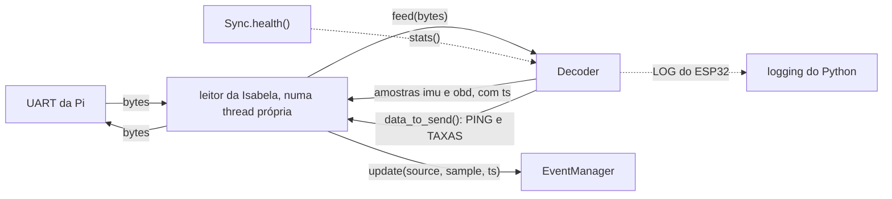

# Decodificador Python e guia do leitor da Pi

O código Python que transforma as mensagens do ESP32 em amostras com o horário da Pi e prepara as mensagens que a Pi envia. Especificação fechada no [ticket #12](https://github.com/V-guard-org/firmware_telemetria/issues/12) em 14/10/2026.

**Falta a confirmação da Isabela** em três pontos, que mudam o código dela:
- o formato das idades no OBD (§3.3);
- a amostra vazia (§3.4);
- a cópia do arquivo para o repositório dela (§2.1).

As decisões por trás deste documento estão nas ADRs:
- [ADR-0002](adr/0002-mensagens-binarias-com-crc-sem-confirmacao.md): mensagens binárias com CRC; o decodificador recebe bytes e devolve dicionários e os bytes a escrever.
- [ADR-0004](adr/0004-horario-pelo-relogio-do-esp32-convertido-na-pi.md): horário pelo relógio do ESP32, convertido na Pi.
- [ADR-0006](adr/0006-formulas-obd-no-decodificador.md): as fórmulas do OBD ficam no decodificador.

O formato no cabo está no [`PROTOCOLO.md`](PROTOCOLO.md). Os termos seguem o [`CONTEXT.md`](../CONTEXT.md).

## Resumo

- **Um arquivo só,** `host/esp32_decoder.py`, feito só com a biblioteca padrão do Python 3.10+, como o `gerenciador_eventos`. A Isabela o copia para o repositório dela.
- **Uma classe, `Decoder`,** que não abre a porta. O leitor da Isabela abre a porta, passa os bytes e escreve o que o decodificador devolve.
- **Quatro chamadas:**
  - `feed(bytes)` devolve as amostras prontas para o `update()`;
  - `data_to_send()` devolve os bytes a escrever (PING e TAXAS);
  - `set_rates()` muda as taxas de envio;
  - `stats()` mostra o estado da ligação e os contadores.
- **Só IMU e OBD** saem do `feed()`. O LOG do ESP32 vai para o `logging` do Python, e o STATUS fica no `stats()`.
- **Amostra vazia:** quando uma fonte para, o decodificador entrega um `{}` uma vez, para que a Pi não trate a última amostra como atual.
- **ESP32 falso:** `host/fake_esp32.py` imita o ESP32 num pty. Com ele, a Isabela testa o leitor sem placa e sem firmware.

## 1. Visão geral



O decodificador tem dois usuários:
- o leitor da Isabela, na Pi (fases 3 e 4);
- o programa do notebook que faz o papel da Pi no desenvolvimento ([#9](https://github.com/V-guard-org/firmware_telemetria/issues/9)), que também mostra o `stats()` ao vivo.

## 2. Guia para a Isabela

### 2.1 Instalação

Copie `host/esp32_decoder.py` para a mesma pasta do `event_manager.py` (`edge/vguard/events/`). Não há nada a instalar.

```python
from esp32_decoder import Decoder
```

O arquivo tem uma constante `VERSION`. A cada mudança, por exemplo a correção de uma fórmula do OBD (ADR-0006), a equipe do firmware sobe a versão e avisa o que mudou. Para atualizar, basta copiar o arquivo de novo.

### 2.2 O leitor

O exemplo abaixo usa só a biblioteca padrão. Ele abre a UART a 460800 baud sem o pyserial; o trecho de `termios` foi testado num pty.

```python
import os
import select
import termios
import threading
import tty

from esp32_decoder import Decoder

PORT = "/dev/ttyAMA5"          # no notebook, com o ESP32 falso ou o firmware nativo: "/tmp/vguard-esp32"


def open_port(path):
    fd = os.open(path, os.O_RDWR | os.O_NOCTTY)
    tty.setraw(fd)             # 8 bits, sem eco e sem tradução de bytes
    attrs = termios.tcgetattr(fd)
    attrs[2] |= termios.CLOCAL | termios.CREAD
    attrs[2] &= ~(termios.CSTOPB | termios.CRTSCTS)   # 1 bit de parada, sem controle de fluxo
    attrs[4] = attrs[5] = termios.B460800
    termios.tcsetattr(fd, termios.TCSANOW, attrs)
    return fd


def read_esp32(manager, decoder, path=PORT):
    fd = open_port(path)
    while True:
        ready, _, _ = select.select([fd], [], [], 0.1)
        data = os.read(fd, 4096) if ready else b""
        for source, ts, sample in decoder.feed(data):
            manager.update(source, sample, ts=ts)
        os.write(fd, decoder.data_to_send())


decoder = Decoder()
threading.Thread(target=read_esp32, args=(manager, decoder), daemon=True).start()
```

- **Thread própria.** O laço nunca termina, então ele precisa de uma thread, como o `Sync`.
- **`feed()` a cada 100 ms, no máximo.** O decodificador também cuida dos tempos dentro do `feed()`: o PING de cada segundo e a percepção de que o ESP32 sumiu. Por isso o `select()` tem limite de 0,1 s, e o `feed(b"")` é válido.
- **Escreva logo o que o `data_to_send()` devolve.** O horário do PING é anotado nessa chamada, e um atraso na escrita entra como erro na sincronização.
- **O `update()` pode pausar o laço.** O `update()` grava no SD uma vez por segundo, com `fsync`. Se um PONG chegar durante essa pausa, a ida e volta medida aumenta, e o decodificador descarta esse par de horários (§3.8). O horário entregue continua certo, então não é preciso separar o `update()` em outra thread.
- **Uma exceção do `feed()` é um defeito do decodificador.** Os bytes da linha nunca causam exceção (§3.9). Se ocorrer uma, avise a equipe do firmware.

### 2.3 O que chega ao `update()`

O `feed()` devolve uma lista, muitas vezes vazia, de trios `(source, ts, sample)`:
- `source` é `"imu"` ou `"obd"`, os nomes de fonte que o `update()` já usa;
- `ts` é a hora real da amostra em segundos (epoch), já convertida (§3.8);
- `sample` é um dicionário novo, serializável em JSON e sem a chave `ts`.

```python
("imu", 1791990000.123, {"ax": -0.62, "ay": 0.1, "az": 9.81, "gx": 0.5, "gy": -1.2, "gz": 12.3,
                         "ax_peak": -0.8, "ay_peak": 0.25, "az_peak": 10.4,
                         "gx_peak": 1.1, "gy_peak": -2.0, "gz_peak": 15.0})
("obd", 1791990000.143, {"rpm": 1726.0, "speed": 60, "age_ms": {"rpm": 40, "speed": 120}})
("obd", 1791990031.500, {})          # amostra vazia: o OBD parou (§3.4)
```

- **IMU** (§3.2): sem sufixo é a média do intervalo, e `_peak` é o pico. Os valores estão em m/s² e °/s, no referencial do carro, com a gravidade incluída.
- **OBD** (§3.3): um número por PID, com o nome da tabela. Um PID que o carro não tem fica ausente. `age_ms` diz há quanto tempo o carro respondeu cada valor; descartar os valores velhos fica com você.
- **Amostra vazia** (§3.4): `{}` uma vez quando a fonte para, para tirar do `_latest` a amostra que deixou de ser atual.

### 2.4 Quando não chega nada

| Situação | O que acontece | Quanto tempo |
|---|---|---|
| O leitor acabou de abrir a porta | Nenhuma amostra, até chegar um STATUS e o 1º PONG válido. O 1º PING sai na criação do `Decoder`. | Até cerca de 1 s, o intervalo do STATUS |
| O ESP32 reiniciou | Nenhuma amostra até o PONG do boot novo. O STATUS sai logo no boot, e o decodificador responde com um PING na hora. | Poucos milissegundos depois do 1º STATUS do boot novo |
| A Pi acabou de aparecer para o ESP32 | IMU logo; OBD só depois que o ESP32 escuta e descobre os PIDs ([`MAQUINAS-DE-ESTADO.md`](MAQUINAS-DE-ESTADO.md) §4) | OBD em cerca de 1,2 s |
| Carro desligado ou sem resposta | Um `{}` do OBD, e depois nada até o carro responder | Enquanto durar |
| Cabo solto ou ESP32 travado | Um `{}` de cada fonte depois de 3 s sem nenhuma mensagem válida | Enquanto durar |
| Firmware com versão de protocolo desconhecida | Nenhuma amostra daquele boot, com um `logging.error` | Até atualizar o decodificador |

As amostras descartadas nesses casos aparecem no contador `unsynced` do `stats()`.

### 2.5 Saúde da ligação

O `stats()` devolve um dicionário com o estado da ligação, os contadores do decodificador e o último STATUS do ESP32 (§3.5). Se quiser pô-lo na saúde do dispositivo (RF32), basta uma linha no `Sync.health()`:

```python
"esp32": decoder.stats(),
```

O `stats()` e o `set_rates()` podem ser chamados de qualquer thread. O `feed()` e o `data_to_send()` são só da thread do leitor.

Para mudar as taxas de envio (RF29), chame `decoder.set_rates(imu=50)`. Sem essa chamada, valem as taxas padrão (25 e 5 amostras/s).

### 2.6 Testar sem o ESP32

```
python3 host/fake_esp32.py
```

O ESP32 falso cria um pty e o atalho `/tmp/vguard-esp32`, o mesmo caminho que o firmware nativo usa na fase 1. Rode o leitor com `PORT = "/tmp/vguard-esp32"`. Ele precisa de Linux ou macOS. As opções para provocar cada caso estão no §4.

## 3. Referência

### 3.1 Chamadas

| Chamada | Devolve | Quem chama e quando |
|---|---|---|
| `Decoder(clock=time)` | — | `clock` é qualquer objeto com `monotonic()` e `time()`. O padrão é o módulo `time`, e os testes passam um relógio falso. |
| `feed(data)` | Lista de `(source, ts, sample)` | Só a thread do leitor, a cada leitura e pelo menos a cada 100 ms, mesmo com `b""` |
| `data_to_send()` | `bytes`, possivelmente vazio | Só a thread do leitor, logo depois de cada `feed()`, escrevendo na hora |
| `set_rates(imu=None, obd=None)` | `None`, ou `ValueError` com valor fora da lista | Qualquer thread |
| `stats()` | `dict` novo a cada chamada | Qualquer thread |

O instante de chegada dos bytes é lido no início de cada `feed()` e vale para todas as mensagens daquele trecho.

### 3.2 Dicionário da IMU

| Chave | Valor | Unidade |
|---|---|---|
| `ax`, `ay`, `az` | Média da aceleração em x (frente), y (esquerda) e z (cima) | m/s², 2 casas |
| `gx`, `gy`, `gz` | Média da rotação em torno de x, y e z, positiva pela regra da mão direita | °/s, 1 casa |
| `ax_peak` … `gz_peak` | Pico de cada eixo: a leitura de maior módulo, com o sinal | As mesmas |

- Os valores são `float`, calculados como o inteiro do cabo dividido por 100 ou por 10. Assim `981` vira `9.81`, sem dígitos espúrios.
- Com o carro parado e nivelado, `az ≈ 9.81`.
- O `ts` é o meio do intervalo da amostra ([`PROTOCOLO.md` §3.2](PROTOCOLO.md)).

### 3.3 Dicionário do OBD

**(a confirmar pela Isabela: o formato de `age_ms`)**

| Chave | PID | Valor | Fórmula | Unidade | Tipo |
|---|---|---|---|---|---|
| `load` | `0x04` | Carga do motor | A·100/255, arredondada a 1 casa | % | `float` |
| `coolant` | `0x05` | Temperatura do líquido de arrefecimento | A − 40 | °C | `int` |
| `map` | `0x0B` | Pressão no coletor | A | kPa | `int` |
| `rpm` | `0x0C` | Rotação | (256A + B)/4 | rpm | `float` |
| `speed` | `0x0D` | Velocidade | A | km/h | `int` |
| `iat` | `0x0F` | Temperatura do ar de admissão | A − 40 | °C | `int` |
| `throttle` | `0x11` | Posição do acelerador | A·100/255, arredondada a 1 casa | % | `float` |
| `voltage` | `0x42` | Tensão do módulo de controle | (256A + B)/1000 | V | `float` |

- **`age_ms`** é um dicionário com as mesmas chaves dos valores presentes. Cada idade é um `int` em milissegundos, contado da resposta do carro até o instante da amostra, e trava em 65535.
- **Arredondamento.** Só `load` e `throttle` são arredondados, porque a resolução é de 0,4%: sem isso, `A = 77` daria `30.19607843137255` no JSON enviado ao backend. As outras fórmulas já dão números curtos.
- **PID ausente.** Um PID que o carro não suporta, ou que nunca respondeu, não aparece. Nunca há `None`.
- **Valor pulado.** Um PID sem fórmula na tabela é pulado pelo `tam` e contado em `skipped_values`, assim como um valor com menos bytes do que a fórmula usa. Para incluir um PID novo, basta acrescentar uma linha na tabela do código e subir a `VERSION`.

Exemplo, com a mensagem OBD do [`PROTOCOLO.md` §8](PROTOCOLO.md):

```python
{"rpm": 1726.0, "speed": 60, "age_ms": {"rpm": 40, "speed": 120}}
```

### 3.4 Amostra vazia

**(a confirmar pela Isabela)**

Quando uma fonte para, o `update()` da Pi guarda a última amostra para sempre no `_latest`. Sem a amostra vazia, depois que o carro parasse de responder, todo evento seguinte sairia com um RPM de minutos atrás.

O decodificador entrega `(source, ts, {})` uma vez quando a fonte para:

| Caso | Fonte | Quando | `ts` |
|---|---|---|---|
| O OBD saiu de LENDO: carro sem resposta, bloqueio, falha do CAN ou ESP32 reiniciado | `obd` | No 1º STATUS sincronizado com `estado_obd` diferente de LENDO | O `t_us` do STATUS, convertido |
| A IMU entrou em falha | `imu` | No 1º STATUS sincronizado com `estado_imu` = falha | O `t_us` do STATUS, convertido |
| O ESP32 está mudo (cabo solto, ESP32 travado) | As duas | 3 s depois da última mensagem válida | A hora da Pi naquele momento |

- **Uma vez por parada.** Só sai o `{}` se a última amostra entregue daquela fonte tinha valores.
- **Retorno.** Quando a fonte volta, as amostras voltam normalmente.
- **Contagem.** As amostras vazias somam em `empty`, e não em `imu` ou `obd`.

### 3.5 `stats()`

```python
{
    "connected": True,           # chegou mensagem válida nos últimos 3 s
    "synced": True,              # o boot atual tem STATUS de versão conhecida e horário sincronizado
    "incompatible": False,       # o STATUS do boot atual tem uma versão de protocolo desconhecida
    "boot": 48879,               # None antes da 1ª mensagem
    "requested_rates": {"imu": 25, "obd": 5},
    "sync": {"pairs": 12, "rtt_ms": 1.8, "age_s": 0.6, "drift_ppm": -12.5},
    "counters": {"lost": 0, "corrupt": 1, "unsynced": 37, "unknown": 0, "skipped_values": 0,
                 "slow_pongs": 3, "imu": 41250, "obd": 8250, "empty": 1, "boots": 2},
    "esp32": {...},              # o último STATUS do boot atual (§3.6), ou None
}
```

**`sync`:**
- `pairs`: pares de horários guardados, no máximo 12 (§3.8);
- `rtt_ms`: ida e volta do último par aceito;
- `age_s`: segundos desde o último par aceito, ou `None` sem nenhum par;
- `drift_ppm`: deriva do relógio do ESP32 estimada pela reta, ou `None` enquanto só o deslocamento é usado.

**Contadores do decodificador.** Somam desde a criação do `Decoder` e nunca zeram.

| Contador | O que conta |
|---|---|
| `lost` | Mensagens perdidas no cabo: lacunas de `seq` dentro do mesmo boot. Depois de 3 s de silêncio, a sequência recomeça sem contar a lacuna. |
| `corrupt` | Mensagens rejeitadas: COBS inválido, menos de 7 bytes, CRC errado ou mais de 258 bytes sem um `0x00` |
| `unsynced` | Amostras descartadas por boot sem STATUS, sem sincronização ou com versão desconhecida |
| `unknown` | Mensagens de tipo desconhecido |
| `skipped_values` | Valores OBD pulados (§3.3) |
| `slow_pongs` | PONGs com ida e volta acima de 20 ms, cujo par foi descartado |
| `imu`, `obd` | Amostras entregues com valores |
| `empty` | Amostras vazias entregues |
| `boots` | Boots diferentes vistos |

Para o critério de "sem perda relevante" (D16), as amostras perdidas são `lost` mais o aumento de `esp32.counters.dropped`, divididas pelo total no ensaio ([`PROTOCOLO.md` §6.6](PROTOCOLO.md)).

### 3.6 STATUS em `stats()["esp32"]`

| Campo do protocolo | Chave | Valor |
|---|---|---|
| `versao` | `protocol` | `int` |
| `t_us` | `uptime_s` | `float`, em segundos |
| `plataforma` | `platform` | `"notebook"` ou `"esp32"` |
| `fontes`, bit 0 | `imu_simulated` | `bool` |
| `reinicio` | `reset_reason` | `"unknown"`, `"power_on"`, `"external_pin"`, `"software"`, `"panic"`, `"watchdog"` ou `"brownout"` |
| `taxa_imu` | `imu_rate` | `int`, em amostras/s |
| `taxa_obd` | `obd_rate` | `int`, em amostras/s |
| `estado_imu` | `imu_state` | `"ok"` ou `"failed"` |
| `estado_obd` | `obd_state` | Tabela abaixo |
| `pids` | `supported_pids` | Lista crescente dos PIDs com o bit ligado, de `0x01` a `0x60` |
| `contadores` | `counters` | `dict`, com os nomes abaixo |
| `heap_min` | `heap_min` | `int`, em bytes |
| `firmware` | `firmware` | `str` |

| Código | Estado ([`MAQUINAS-DE-ESTADO.md`](MAQUINAS-DE-ESTADO.md) §2) | `obd_state` |
|---|---|---|
| 0 | ESPERANDO_PI | `"waiting_pi"` |
| 1 | ESCUTANDO | `"listening"` |
| 2 | DESCOBRINDO | `"discovering"` |
| 3 | LENDO | `"reading"` |
| 4 | SEM_RESPOSTA | `"no_response"` |
| 5 | VELOCIDADE_ERRADA | `"wrong_bitrate"` |
| 6 | LINHA_PRESA | `"line_stuck"` |
| 7 | FALHA_CAN | `"can_failure"` |
| 8 | BLOQUEADO | `"locked"` |

Um código fora das tabelas vira `"unknown"`.

**Contadores do ESP32**, na ordem do protocolo: `descartadas` → `dropped`, `rejeitadas` → `rejected`, `falhas_imu` → `imu_failures`, `obd_enviadas` → `obd_sent`, `obd_respondidas` → `obd_answered`, `obd_sem_resposta` → `obd_timeouts`, `bloqueadas` → `blocked`, `erros_can` → `can_errors`, `bus_off` → `bus_off`. Eles somam desde o boot do ESP32 e zeram a cada reinício.

### 3.7 O que o decodificador envia

O `data_to_send()` devolve, num único `bytes`, tudo o que está pendente:
- **PING:** o 1º na primeira chamada depois da criação do `Decoder`, e depois 1 por segundo, mesmo sem ESP32 na linha. Sai mais um logo depois de perceber um boot novo. O instante `t1` do par é anotado na chamada que devolve o PING.
- **TAXAS:** no máximo uma por STATUS cujas taxas em uso diferem das pedidas, sempre com os dois valores pedidos ([`PROTOCOLO.md` §6.4](PROTOCOLO.md)).

No cabeçalho, `boot` vale 0, e `seq` começa em 0 na criação do `Decoder` e soma 1 a cada mensagem. O PING do [`PROTOCOLO.md` §8](PROTOCOLO.md) é um vetor de teste.

Um PONG é casado com o PING pelo `seq_ping`. Um PONG sem PING correspondente nos últimos 3 s é ignorado.

### 3.8 Sincronização do horário

Valores iniciais, em constantes no topo do arquivo, a calibrar na bancada ([#13](https://github.com/V-guard-org/firmware_telemetria/issues/13)):

| Constante | Valor | Função |
|---|---|---|
| `PING_INTERVAL_S` | 1,0 | Intervalo entre PINGs |
| `MAX_RTT_S` | 0,020 | Ida e volta máxima de um par válido; o erro do par fica em até 10 ms (D12) |
| `BUCKET_S` | 10 | De cada intervalo de 10 s, só o par mais rápido é guardado |
| `BUCKETS` | 12 | Pares usados na reta, ou seja, os últimos 2 min |
| `MIN_SPAN_S` | 30 | Com pares cobrindo menos que isso, só o deslocamento é usado |
| `LINK_TIMEOUT_S` | 3,0 | Silêncio que conta como ESP32 mudo |

Como funciona:
1. Cada PONG válido dá um par: o meio da ida e volta, `(t1 + t2)/2`, no relógio monotônico da Pi, e o `t_us` do PONG.
2. De cada intervalo de 10 s, só o par com a menor ida e volta é guardado. O intervalo em curso também conta, com o melhor par até o momento. Pares atrasados por uma pausa do leitor perdem para os rápidos.
3. Com os pares guardados, o decodificador ajusta por mínimos quadrados a reta `monotônico = a + b·t_us`. A reta corrige o deslocamento e a deriva do cristal.
4. Enquanto os pares cobrirem menos de 30 s, ele usa só o deslocamento do par mais recente, com `b` nominal. Com pares a só 10 s de distância, 1 ms de ruído já daria 100 ppm de erro na inclinação, mais do que a deriva de um cristal comum.
5. As amostras de um boot começam a sair no 1º par válido desse boot.
6. Se os pares pararem de chegar, ele segue entregando pela reta, e `stats()["sync"]["age_s"]` mostra há quanto tempo.
7. Num boot novo, todos os pares são descartados.
8. Na entrega, o horário monotônico vira hora real com `time.time() − time.monotonic()` calculado naquele momento. Se o chrony corrigir a hora da Pi aos saltos, as amostras seguintes já saem certas ([`PROTOCOLO.md` §6.3](PROTOCOLO.md)).

### 3.9 Erros

- **Bytes da linha.** O `feed()` nunca levanta exceção por causa deles: lixo, mensagens corrompidas, tipos desconhecidos e valores estranhos viram contadores.
- **Taxa inválida.** O `set_rates()` levanta `ValueError` e não muda nada. Os valores aceitos são 100, 50, 25, 20 e 10 para a IMU, e 1, 2, 5 e 10 para o OBD ([`PROTOCOLO.md` §4.2](PROTOCOLO.md)). Por isso, um valor inválido nunca chega ao cabo.
- **Versão desconhecida no STATUS.** O decodificador chama `logging.error` uma vez por boot, marca `incompatible` no `stats()` e não entrega nenhuma amostra daquele boot, que entram em `unsynced`. Os PINGs continuam.
- **LOG do ESP32.** Vai para o logger `esp32` do `logging`: o nível 1 (erro) como `ERROR`, e o nível 2 (aviso) e qualquer outro como `WARNING`.
- **Erros da porta** (`OSError` ao abrir, ler ou escrever) são do leitor.

### 3.10 Versões

- `VERSION`: a versão do decodificador, como `"1.0.0"`. Sobe a cada mudança no arquivo.
- `PROTOCOL_VERSIONS = (1,)`: as versões do protocolo que ele entende.

## 4. ESP32 falso

`host/fake_esp32.py` imita o ESP32 no cabo, para testar o leitor e o decodificador sem placa e sem firmware.

```
python3 host/fake_esp32.py [--path /tmp/vguard-esp32] [opções]
```

- **Ligação.** Cria um pty e o atalho no caminho dado. O padrão é o mesmo do firmware nativo ([`PLATAFORMA.md` §4.2](PLATAFORMA.md)), então o leitor não muda.
- **Comportamento.** Segue o [`PROTOCOLO.md`](PROTOCOLO.md):
  - sorteia o `boot` e envia o STATUS logo ao iniciar e depois 1 vez por segundo, com plataforma 0, IMU simulada e firmware `fake-<VERSION>`;
  - envia IMU na taxa pedida, 25/s por padrão;
  - envia OBD com os 8 PIDs, só com a Pi presente, como o firmware: cerca de 1,2 s depois do 1º PING, e nada depois de 3 s sem PING;
  - responde a cada PING com um PONG e aplica o TAXAS, contando em `rejeitadas` os valores fora da lista;
  - envia um LOG de aviso ao iniciar.
- **Valores.** Seguem um percurso de 60 s em laço: parado, acelera até 60 km/h, anda e freia. A IMU e o OBD seguem o mesmo percurso.
- **Opções para provocar cada caso:**

| Opção | O que faz |
|---|---|
| `--car-off-after S` | O carro para de responder depois de S segundos: o OBD some e o STATUS mostra SEM_RESPOSTA |
| `--reboot-every S` | Reinicia a cada S segundos, com um boot novo e as taxas padrão |
| `--garbage` | Põe 20 bytes aleatórios na linha a cada segundo |
| `--drift-ppm N` | Faz o relógio do ESP32 falso andar N ppm mais rápido, para testar a sincronização |

- **Moldura.** O ESP32 falso importa o COBS e o CRC do `esp32_decoder.py` e só acrescenta a montagem das mensagens do ESP32. Para que um defeito comum aos dois não passe despercebido, os testes do decodificador usam os vetores do [`PROTOCOLO.md` §8](PROTOCOLO.md).
- **Permanência.** Não é simulação dentro do firmware, então a ADR-0003 não se aplica: ele fica no projeto, como a ECU simulada.

## 5. Arquivos

```
host/
  esp32_decoder.py        o decodificador: arquivo único, só biblioteca padrão (Python 3.10+)
  fake_esp32.py           o ESP32 falso
  test_esp32_decoder.py   testes, com os vetores do PROTOCOLO.md §8 e um relógio falso
```

O código e os nomes ficam em inglês (D18).

## 6. Fora deste documento

- **Ticket [#9](https://github.com/V-guard-org/firmware_telemetria/issues/9):** o programa do notebook que faz o papel da Pi usa este decodificador. É ele que envia o PING e mostra o `stats()` ao vivo.
- **Ticket [#13](https://github.com/V-guard-org/firmware_telemetria/issues/13):** calibrar a sincronização (§3.8), medindo o erro do horário na bancada, e testar o decodificador ponta a ponta com o ESP32 falso e com o firmware.
- **Isabela:** o leitor da UART e o `gerenciador_eventos`, incluindo o limite de idade para descartar valores do OBD e o uso do `stats()` na saúde do dispositivo.
- **Nicolas:** o chrony com o PPS do GPS, que faz da hora da Pi o horário GPS.
