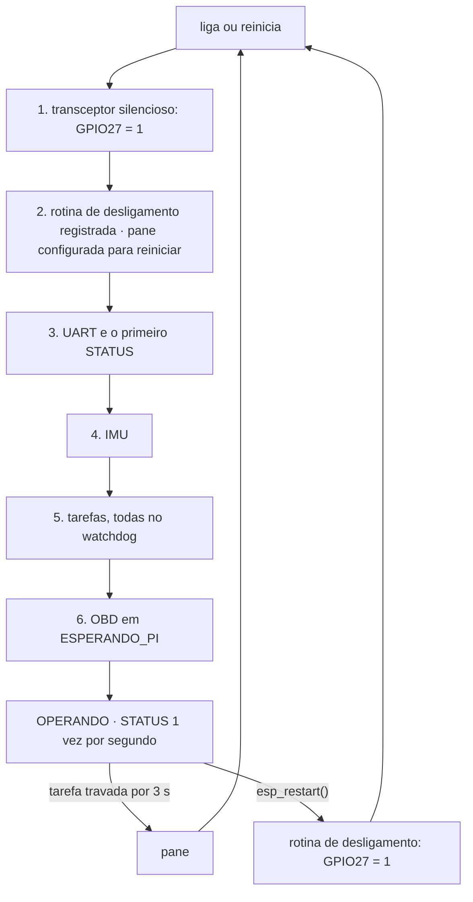
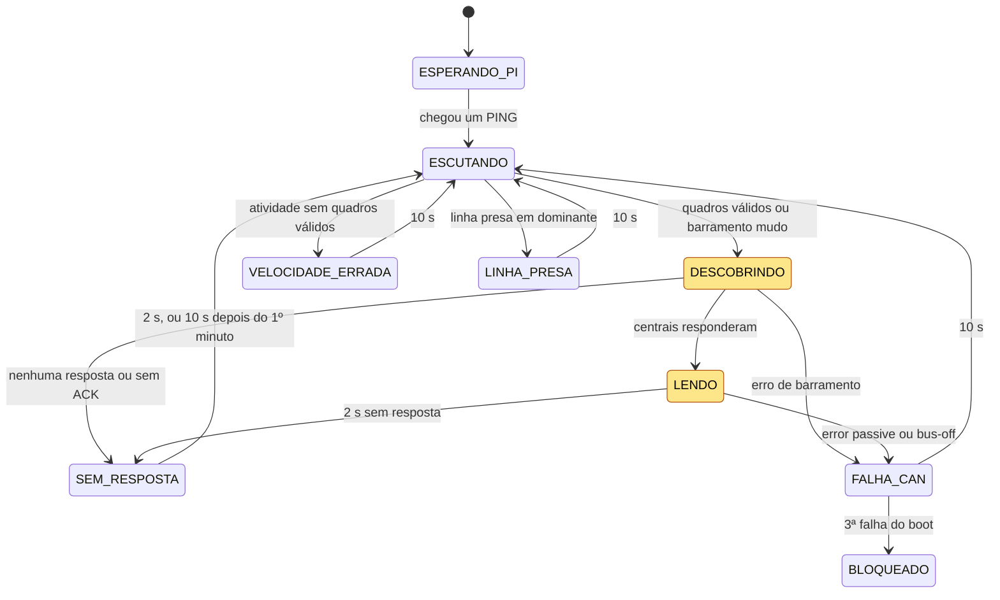
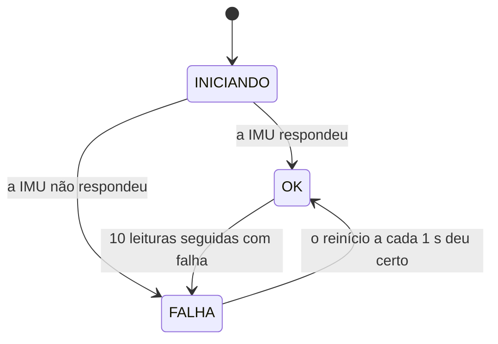

# Máquinas de estado do firmware

Como o firmware se comporta ao longo do tempo: o boot, o OBD no barramento CAN e a IMU. Especificação fechada no [ticket #8](https://github.com/V-guard-org/firmware_telemetria/issues/8) em 14/10/2026.

As decisões por trás deste documento estão nas ADRs:
- [ADR-0001](adr/0001-obd-por-requisicao-padronizada.md): o OBD funciona por requisição padronizada.
- [ADR-0007](adr/0007-transmitir-o-minimo-no-can.md): o ESP32 transmite o mínimo no CAN.

O formato das mensagens está no [`PROTOCOLO.md`](PROTOCOLO.md), e os termos seguem o [`CONTEXT.md`](../CONTEXT.md).

## Resumo

- **Supervisor.** O transceptor CAN fica silencioso já na 1ª linha do programa. Todas as tarefas ficam no watchdog, e uma pane sempre leva a um reinício.
- **OBD.** O ESP32 só transmite com a Pi presente, depois de escutar 1 s, e cada quadro tem uma única tentativa. O transceptor só fica liberado durante a descoberta e a leitura. Falhas repetidas levam ao bloqueio até reiniciar.
- **IMU.** Depois de 10 leituras seguidas com falha, a IMU entra em falha. O ESP32 tenta reiniciá-la a cada 1 s, e o OBD não é afetado.

## 1. Supervisor

- **Passo 1, antes de tudo.** O nível 1 é gravado no GPIO27 antes de o pino ser configurado como saída *open-drain*, para que ele nunca pulse em 0. É necessário porque, no ESP32 clássico, o `esp_restart()` e o reinício depois de uma pane não reiniciam os GPIOs ([pesquisa do #4](https://github.com/V-guard-org/firmware_telemetria/issues/4)). Sem esse passo, o transceptor continuaria liberado.
- **Passo 2.** A rotina registrada com `esp_register_shutdown_handler()` silencia o transceptor antes de um `esp_restart()`. A pane não passa por ela, e por isso o passo 1 é o que cobre a pane. A pane fica configurada para reiniciar (`CONFIG_ESP_SYSTEM_PANIC_PRINT_REBOOT`), nunca para parar o processador.
- **Sem *hook* no bootloader.** Depois de uma pane, o transceptor pode ficar liberado por algumas centenas de ms até o passo 1. Nesse intervalo, o processador não envia nada, e com tentativa única o controlador não repete o último quadro.
- **Watchdog.** O prazo é de 3 s. O STATUS informa o motivo do reinício: 5 para o watchdog e 4 para outras panes.
- **Sem modo de segurança** para reinícios em sequência. Cada boot escuta 1 s antes de falar, então um ESP32 reiniciando sem parar nunca transmite no CAN.
- **Presença da Pi.** Não é um estado do supervisor: é uma condição que o OBD consulta. A Pi conta como presente se mandou um PING nos últimos 3 s.

## 2. OBD

Os estados em amarelo são os únicos em que o transceptor fica liberado. Duas transições valem a partir de qualquer estado e não aparecem no desenho, para não poluí-lo:
- **A Pi sumiu** (3 s sem PING): o transceptor fica silencioso, e o estado passa a ESPERANDO_PI. Vale em qualquer estado, exceto BLOQUEADO.
- **Violação da lista fechada:** o estado passa a BLOQUEADO.

Ao sair de LENDO, por qualquer motivo, os valores OBD são esquecidos e as amostras OBD param.

| Valor | Estado | Transceptor | O que faz |
|---|---|---|---|
| 0 | ESPERANDO_PI | silencioso | Nada no CAN |
| 1 | ESCUTANDO | silencioso | Escuta por 1 s (§2.1) |
| 2 | DESCOBRINDO | liberado | Descobre as centrais e os PIDs (§2.3) |
| 3 | LENDO | liberado | Segue a agenda (§2.4) |
| 4 | SEM_RESPOSTA | silencioso | Espera para perguntar de novo (§2.5) |
| 5 | VELOCIDADE_ERRADA | silencioso | Espera 10 s, sem nunca transmitir |
| 6 | LINHA_PRESA | silencioso | Espera 10 s, sem nunca transmitir |
| 7 | FALHA_CAN | silencioso | Conta a falha, recupera e espera 10 s (§2.6) |
| 8 | BLOQUEADO | silencioso | Nada, até reiniciar |

O valor de cada estado é o `estado_obd` do STATUS.

### 2.1 Escuta

O transceptor fica silencioso e o controlador em listen-only por 1 s. O resultado depende do que o ESP32 viu:

| O que viu | Significa | Próximo estado |
|---|---|---|
| Pelo menos um quadro válido | O barramento está a 500 kbit/s (D3) | DESCOBRINDO |
| Nenhuma transição na linha | Barramento mudo (gateway) ou carro dormindo | DESCOBRINDO; a 1ª requisição confirma a velocidade |
| Transições, mas nenhum quadro válido | Outra velocidade | VELOCIDADE_ERRADA |
| Dominante contínuo por mais de 10 ms | Curto ou defeito na fiação | LINHA_PRESA |

O ESP32 percebe a atividade e a linha presa lendo o próprio pino RX (GPIO26). Os contadores de erro do controlador não servem para isso, porque ficam congelados em listen-only. A camada de plataforma conta tudo isso e entrega ao núcleo um resumo da escuta ([`PLATAFORMA.md` §3.1](PLATAFORMA.md)).

### 2.2 Liberar e silenciar o transceptor

**Para liberar**, na passagem de ESCUTANDO para DESCOBRINDO:
1. GPIO27 = 0. O controlador ainda está em listen-only, então nada sai.
2. Esperar pelo menos 10 µs.
3. Recriar o nó TWAI em modo normal, com tentativa única (`fail_retry_cnt = 0`). Antes de entrar no barramento, o controlador espera 11 bits recessivos.

**Para silenciar**, a cada saída de DESCOBRINDO ou LENDO:
1. GPIO27 = 1.
2. Recriar o nó TWAI em listen-only. O nó novo começa em *error active*, com os contadores zerados, então silenciar também tira o controlador do *bus-off*.

Na camada de plataforma, liberar e silenciar são as ações `talk()` e `listen()` da porta CAN. Cada uma executa a sequência inteira, e o código portátil nunca vê o GPIO27 ([`PLATAFORMA.md` §3.1](PLATAFORMA.md)).

A ordem nunca se inverte. Com o transceptor silencioso e o controlador em modo normal, o controlador veria erros no próprio ACK.

**Tentativa única.** Sem ninguém para dar ACK, a retransmissão automática repetiria o mesmo quadro para sempre: no *error passive*, o contador de erros para de subir. No ESP32 clássico, qualquer `fail_retry_cnt` diferente de −1 já liga o modo de tentativa única no hardware (conferido no ESP-IDF 6.1).

O driver informa por que um quadro falhou:

| Motivo (`twai_error_flags_t`) | Significa | O que o firmware faz |
|---|---|---|
| `arb_lost` | Perdeu a disputa com o tráfego do carro | Tenta de novo no próximo horário; não conta como falta |
| `ack_err` | Ninguém deu ACK | Conta como falta de resposta |
| `bit_err`, `form_err`, `stuff_err` | Erro de barramento | Na descoberta, vai para FALHA_CAN; na leitura, só os estados *error passive* e *bus-off* levam a FALHA_CAN |

### 2.3 Descoberta

1. Pergunta 01 00 a todas as centrais (ID `0x7DF`) e recolhe as respostas de `0x7E8` a `0x7EF` por 50 ms.
   - Sem ACK, ou sem nenhuma resposta: SEM_RESPOSTA.
   - Erro de barramento: FALHA_CAN.
2. Se alguma central indicar suporte a 0x20, pergunta 01 20; depois, do mesmo jeito, 01 40. Uma pergunta sem resposta encerra a descoberta com o que já se tem.
3. O mapa do STATUS (`pids`) passa a ser a união dos mapas de todas as centrais.
4. Para cada PID da lista da D6, escolhe a central de menor endereço que o suporta. A partir daí, pergunta só a ela: o ID da requisição é o da resposta menos 8, por exemplo `0x7E0` para `0x7E8`. Assim chega uma única resposta por PID, e os outros módulos não são incomodados.
5. Passa a LENDO. Se o carro não tiver nenhum PID da lista, entra em LENDO com a agenda vazia: não faz requisições, não envia amostras OBD, e o STATUS mostra o mapa do carro.

### 2.4 Leitura

- **Uma requisição por vez.** A próxima só sai depois da resposta, ou de 50 ms sem resposta (prazo da ISO 15765-4), e com no mínimo 50 ms entre requisições, o teto de 20/s da D2.
- **Agenda.** RPM (`0x0C`) e velocidade (`0x0D`) a cada 200 ms; os outros PIDs a cada 1 s. A cada horário de envio vai o PID mais atrasado em relação ao seu período. Com os 8 PIDs, são cerca de 16 requisições/s.
- **Um PID por requisição.** Respostas em vários quadros são ignoradas, porque pedir a continuação exigiria transmitir um quadro de controle de fluxo, que a lista fechada não permite.
- **Resposta válida:** vem da central escolhida, no modo `0x41`, com o PID pedido e bytes suficientes. Os bytes crus e o instante são guardados. Uma resposta atrasada ainda vale como valor do seu PID.
- **PID que não responde.** Uma falta só conta se o carro respondeu a outra requisição desde a pergunta anterior a esse PID. Depois de 5 faltas seguidas, o PID sai da agenda até a próxima descoberta e some da amostra.
  - Assim, quando o carro inteiro se cala, nenhum PID sai da agenda. Os valores ficam na amostra, com a idade crescendo, até a regra dos 2 s abaixo.
  - Sem essa condição, o RPM e a velocidade, perguntados a cada 200 ms, sairiam da agenda 1 s depois de a ignição desligar. Uma agenda só com eles ficaria vazia antes dos 2 s, e o OBD pararia em LENDO sem perguntar nada (achado do protótipo do #9, Q13).
- **Carro sem resposta.** Depois de 2 s sem nenhuma resposta, o estado passa a SEM_RESPOSTA. Os 2 s toleram as centrais que reiniciam na partida do motor. A regra só vale com a agenda não vazia: com a agenda vazia (§2.3, passo 5), não há requisições, e o estado fica em LENDO.
- **Falha.** Os estados *error passive* ou *bus-off* (`on_state_change`) levam a FALHA_CAN.
- **Amostras OBD.** Saem na taxa de envio do OBD, independentes da agenda, com os valores que existirem naquele instante.

### 2.5 Sem resposta

O transceptor fica silencioso. O ESP32 espera 2 s se o carro parou de responder há menos de 1 minuto, e 10 s depois disso. Então volta a ESCUTANDO, e o ciclo escuta → 01 00 se repete. O minuto conta a partir da última vez em que o ESP32 esteve em LENDO.

Numa noite de 10 h com o sistema ligado, isso dá cerca de 3 600 perguntas, uma a cada 10 s. Ao dar a partida, os dados chegam em até cerca de 11 s.

### 2.6 Falhas e bloqueio

**FALHA_CAN.** São três casos:
- *error passive*;
- *bus-off*;
- erro de barramento na 1ª requisição, que é a velocidade errada num barramento mudo.

Ao entrar em FALHA_CAN:
1. O transceptor fica silencioso, e o nó é recriado em listen-only (§2.2). Isso também tira o controlador do *bus-off*.
2. A falha é contada.
3. Espera 10 s e volta a ESCUTANDO.

O firmware não usa `twai_node_recover()` (#10 Q3). A norma pede 128 × 11 bits recessivos (2,8 ms a 500 kbit/s) antes de um nó em *bus-off* voltar a falar, e o firmware espera 10 s e ainda escuta 1 s. Uma linha presa, que travaria a recuperação, aparece na escuta como LINHA_PRESA.

**BLOQUEADO**, até reiniciar. Há dois caminhos:
- **A 3ª falha do mesmo boot.** VELOCIDADE_ERRADA e LINHA_PRESA não contam para o limite, porque nesses estados o ESP32 não transmitiu.
- **Uma violação da lista fechada,** que só acontece por defeito no código. O quadro é barrado, contado em `bloqueadas` e registrado num LOG de erro.

### 2.7 Tempos

| Constante | Valor | Origem |
|---|---|---|
| Duração da escuta | 1 s | #8 Q1 |
| Linha presa | Dominante contínuo por mais de 10 ms | #8 |
| Espera depois da escuta reprovada | 10 s | #8 Q1 |
| Liberação do transceptor | Pelo menos 10 µs | #4 |
| Prazo de resposta | 50 ms | ISO 15765-4 |
| Intervalo mínimo entre requisições | 50 ms (20/s) | D2 |
| Período do RPM e da velocidade | 200 ms | #8 Q5 |
| Período dos outros PIDs | 1 s | #8 Q5 |
| Faltas para tirar um PID da agenda | 5 seguidas, contadas só enquanto o carro responde a outras requisições | #8 Q9, #9 Q13 |
| Carro sem resposta | 2 s | #8 Q6 |
| Nova pergunta sem resposta | 2 s no 1º minuto, depois 10 s | #8 Q7 |
| Espera depois de uma falha | 10 s | #8 Q8 |
| Falhas até o bloqueio | 3 por boot | #8 Q8 |
| Pi ausente | 3 s sem PING | #8 Q3 |

Os tempos têm três origens: norma e datasheet, escolhas nossas e comportamento do carro ([`TESTES.md` §14](TESTES.md)). A bancada só confere que funcionam como estão escritos. Os do 3º grupo (os 2 s sem resposta e as 5 faltas) dependem do carro e são conferidos no ensaio no carro (#13 Q13).

## 3. IMU

- **OK.** São 100 leituras por segundo. Uma leitura com falha é só somada em `falhas_imu`, e a amostra usa as leituras válidas ([`PROTOCOLO.md` §3.2](PROTOCOLO.md)).
- **FALHA.** Não saem amostras de IMU, e o STATUS mostra `estado_imu = 1`. O OBD segue normalmente (RNF19).
- **Simulação.** Com a IMU simulada, a falha só acontece se o simulador a provocar.

## 4. Cenários

| Cenário | Caminho | Resultado |
|---|---|---|
| O carro liga com a Pi pronta | ESPERANDO_PI → ESCUTANDO → DESCOBRINDO → LENDO | Valores OBD em cerca de 1,2 s depois do 1º PING |
| Partida do motor: as centrais reiniciam por cerca de 0,5 s | Continua em LENDO, porque são menos de 2 s | Não há interrupção; as idades crescem por um momento |
| A ignição é desligada | LENDO → SEM_RESPOSTA, depois de 2 s; nenhum PID sai da agenda antes disso | As amostras OBD param, todas ao mesmo tempo; uma pergunta a cada 2 s e, depois de 1 minuto, a cada 10 s |
| O carro está a 250 kbit/s e tem tráfego | ESCUTANDO → VELOCIDADE_ERRADA, a cada 10 s | Nunca transmite; STATUS com o estado 5 |
| O carro está a 250 kbit/s e é mudo (gateway) | ESCUTANDO → DESCOBRINDO → FALHA_CAN, três vezes → BLOQUEADO | 3 quadros ao todo, em cerca de 22 s; STATUS com o estado 8 |
| Curto na fiação do CAN | ESCUTANDO → LINHA_PRESA, a cada 10 s | Nunca transmite; STATUS com o estado 6 |
| A Pi trava ou é desligada | Qualquer estado → ESPERANDO_PI, depois de 3 s | O CAN fica silencioso, e a IMU segue |
| O firmware trava | Watchdog de 3 s → pane → reinício → silencioso na 1ª linha | Volta a ESPERANDO_PI; STATUS com o motivo 5 |
| Um defeito tenta enviar um quadro fora da lista | Quadro barrado → BLOQUEADO | `bloqueadas` = 1 e um LOG de erro |
| O carro diz suportar 0x42, mas nunca responde | 5 faltas → 0x42 sai da agenda | A tensão some da amostra, e os outros PIDs não são atrasados |

Cada cenário vira um teste do núcleo ([`TESTES.md` §3.1](TESTES.md)), e os que dependem do hardware são repetidos na bancada ([`TESTES.md` §10.3](TESTES.md)).

## 5. Fora deste documento

- **[`PLATAFORMA.md`](PLATAFORMA.md)** (ticket #10): como a camada de plataforma oferece ao núcleo o pino de liberação, a recriação do nó, o resumo da escuta, os motivos de falha e o relógio.
- **Driver CAN (ticket #14):** o firmware usa o driver TWAI novo do ESP-IDF 6.1, que tem tudo o que este documento usa: `fail_retry_cnt`, `ack_err`, `arb_lost`, `on_state_change` e o modo listen-only.
- **[`TESTES.md`](TESTES.md)** (ticket #13): como provar cada cenário, no notebook e na bancada.
