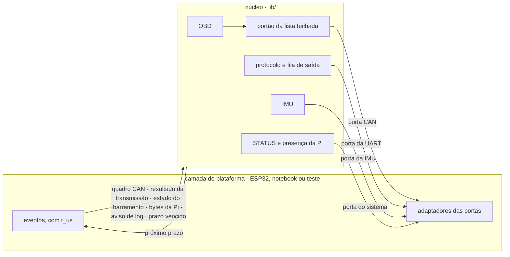

# Núcleo e camada de plataforma

Onde passa a costura entre o código portátil, testado no notebook, e a camada de plataforma, que muda entre o notebook e o ESP32. Especificação fechada no [ticket #10](https://github.com/V-guard-org/firmware_telemetria/issues/10) em 14/10/2026.

As decisões por trás deste documento estão nas ADRs:
- [ADR-0003](adr/0003-simulacao-ou-real-nunca-os-dois.md): simulação e fontes reais nunca convivem no projeto.
- [ADR-0005](adr/0005-codigo-testado-no-notebook-antes-das-placas.md): o código é testado no notebook antes de ir para as placas.
- [ADR-0008](adr/0008-nucleo-passivo-chamado-pela-plataforma.md): o código portátil é um núcleo passivo, chamado pela plataforma.
- [ADR-0009](adr/0009-imu-sim-pelo-usb-na-fase-4.md): na fase 4, a IMU simulada recebe a IMU_SIM pelo USB.

O comportamento que o núcleo implementa está no [`PROTOCOLO.md`](PROTOCOLO.md) e no [`MAQUINAS-DE-ESTADO.md`](MAQUINAS-DE-ESTADO.md). Os termos seguem o [`CONTEXT.md`](../CONTEXT.md).

## Resumo

- **Núcleo passivo.** O código portátil (OBD, IMU, protocolo, STATUS e presença da Pi) forma um núcleo que nunca espera, nunca cria tarefas e nunca pergunta a hora.
  - A plataforma chama o núcleo a cada evento, sempre com o instante (`t_us`).
  - O núcleo age chamando as portas e, ao final de cada chamada, informa o seu próximo prazo.
- **Quatro portas:** CAN, UART, IMU e sistema. Cada uma tem um adaptador por plataforma e um adaptador falso para os testes.
- **Transceptor.** Liberar e silenciar são ações completas da porta CAN, chamadas `falar()` e `escutar()`. O GPIO27 nunca aparece no núcleo.
- **Lista fechada.** O portão é a única passagem do OBD até a porta CAN.
- **Erros de CAN.** Existem só nos testes, com a porta CAN falsa, e na bancada da fase 2. O `vcan` do notebook não tem ACK nem erros de barramento.
- **IMU simulada.** É um adaptador da porta da IMU, alimentado pelo simulador do PC com a mensagem de desenvolvimento IMU_SIM (`0x83`). Fica numa pasta própria e sai inteira quando a simulação for apagada.

## 1. Visão geral



| | ESP32 (`src/vguard/`) | Notebook (`src/native/`) | Testes (`test/`) |
|---|---|---|---|
| Laço | Uma tarefa que lê uma fila de eventos com prazo | Uma thread com `poll()` no `vcan0` e no pty | Chamadas diretas, com relógio falso |
| Relógio | `esp_timer_get_time()` | `CLOCK_MONOTONIC`, contado desde a partida do programa | O teste escolhe o instante |
| CAN | TWAI (`esp_twai.h`), GPIO27, PCNT no GPIO26 | SocketCAN no `vcan0` | Porta falsa, com roteiro |
| UART | UART do ESP32, a 460800 baud | Par de pseudo-terminais | Porta falsa, que guarda os bytes |
| IMU | Driver real (T14.1) ou IMU simulada | IMU simulada | Porta falsa |

## 2. O núcleo

### 2.1 Entradas

O núcleo só faz alguma coisa quando a plataforma o chama. Cada chamada traz o instante do evento.

| Evento | No ESP32, quem gera | No notebook, quem gera | O que o núcleo faz |
|---|---|---|---|
| Partida | `app_main`, depois dos passos 1 e 2 do boot | `main` | Envia o 1º STATUS, inicia a IMU e põe o OBD em ESPERANDO_PI |
| Quadro CAN recebido | Callback `on_rx_done` do TWAI | Leitura do socket CAN | Entrega à máquina do OBD |
| Resultado da transmissão | Callbacks `on_error` e `on_tx_done`, juntados num resultado só (§3.1) | O próprio adaptador, logo depois do `write()` | Entrega à máquina do OBD |
| Estado do barramento | Callback `on_state_change` | Nunca acontece | Conta `bus_off`; *error passive* e *bus-off* levam a FALHA_CAN |
| Bytes da Pi | Tarefa leitora da UART | Leitura do pty | Remonta as mensagens, responde ao PING e aplica TAXAS |
| Bytes do USB (só na fase 4, com a IMU simulada) | Tarefa leitora da UART0 (§5) | Não há: a IMU_SIM chega pelo pty | Remonta as mensagens e entrega só as de desenvolvimento |
| Aviso de log | Gancho de log do ESP-IDF | Não há | Vira uma mensagem LOG, com o limite de 10/s |
| Prazo vencido | Fim da espera na fila | Fim do `poll()` | Executa o que estava marcado para aquele instante |

Depois de cada chamada, o núcleo informa o seu **próximo prazo**, o instante mais próximo entre:
- a próxima leitura da IMU (a cada 10 ms);
- o fim da escuta (1 s);
- o prazo de resposta e o intervalo mínimo entre requisições (50 ms);
- o próximo STATUS (1 s);
- a Pi ausente (3 s sem PING);
- as esperas do OBD (2 s e 10 s) e a nova tentativa da IMU (1 s);
- a nova tentativa de escrita (10 ms), só enquanto a UART recusa a próxima mensagem da fila. Nenhum evento avisa quando a UART volta a aceitar, então o núcleo tenta de novo (emenda do #19).

A plataforma espera até esse prazo ou até o próximo evento, o que vier primeiro.

Esboço em C++, para os tickets de implementação. Os nomes podem mudar, mas o formato fica:

```cpp
// lib/core: as únicas entradas do código portátil
class Core {
public:
    Core(CanPort& can, LinkPort& link, ImuPort& imu, SystemPort& system, const BootInfo& boot);

    void start(uint64_t now_us);
    void on_can_frame(const CanFrame& frame, uint64_t t_us);
    void on_can_tx_result(TxResult result, uint64_t t_us);
    void on_can_bus_state(BusState state, uint64_t t_us);
    void on_link_bytes(const uint8_t* data, size_t len, uint64_t t_us);
    void on_dev_bytes(const uint8_t* data, size_t len, uint64_t t_us);   // fase 4, UART0 (§5)
    void on_platform_log(LogLevel level, const char* text, uint64_t t_us);
    void on_deadline(uint64_t now_us);

    uint64_t next_deadline_us() const;

    // Mensagens de desenvolvimento (0x80–0xFF que o núcleo não conhece), §5
    void register_dev_handler(uint8_t type, DevMessageHandler& handler);
};
```

`BootInfo` traz o que é fixo durante o boot: o `boot` sorteado, o motivo do último reinício (já no código do protocolo, [`PROTOCOLO.md` §3.1](PROTOCOLO.md)), a plataforma e a versão do firmware.

### 2.2 Regras do código portátil

Valem para todo o `lib/`:
- C++17, sem cabeçalhos do ESP-IDF, do FreeRTOS ou do Linux.
- Sem exceções e sem RTTI. O ambiente `native` já recusa os dois, como o ESP-IDF ([pesquisa do #6](https://github.com/V-guard-org/firmware_telemetria/issues/6)).
- **Sem alocar memória depois da inicialização.** Filas e buffers têm tamanho fixo. Todos os tamanhos já são limitados: mensagens de até 255 bytes, 8 PIDs e a fila de saída. Assim a memória não se fragmenta no ensaio de 2 h (D16), e o `heap_min` do STATUS fica estável.
- **Sem threads nem mutexes.** O núcleo é chamado por um único laço.
- **Nenhuma operação demora.** A mais lenta é a leitura da IMU, com menos de 1 ms. Uma operação lenta no futuro, como gravar na flash, iria para a plataforma.
- Cada porta é uma classe abstrata, com um adaptador por plataforma e um falso para os testes.

## 3. Portas

### 3.1 Porta CAN

| Operação | O que garante | ESP32 | Notebook |
|---|---|---|---|
| `listen()` | Transceptor silencioso e controlador só escutando. Começa um resumo da escuta novo. | GPIO27 = 1; apaga o nó, o que funciona até em *bus-off*; cria o nó em listen-only, aceitando todos os quadros; zera os contadores | Passa a só contar os quadros lidos |
| `talk()` | Transceptor liberado e controlador em modo normal, com tentativa única | GPIO27 = 0; espera pelo menos 10 µs; recria o nó em modo normal, com `fail_retry_cnt = 0` e o filtro em `0x7E8`–`0x7EF` | Filtro do socket (`CAN_RAW_FILTER`) em `0x7E8`–`0x7EF` |
| `transmit(quadro)` | Um quadro por vez. O resultado chega depois, como evento. | `twai_node_transmit()` | `write()` no socket |
| `listen_summary()` | O que se viu desde o último `listen()` | Contadores da interrupção e do PCNT (abaixo) | Quadros lidos; nenhuma linha presa |

- **A ordem do #8 §2.2 fica dentro de `talk()` e `listen()`.** Ela nunca se inverte, porque o núcleo não consegue chamar os passos separados. O pino e a ordem se provam na bancada, com o osciloscópio ([`TESTES.md` §10.4](TESTES.md)). No notebook não há transceptor.
- **Saída do *bus-off*.** Todo `listen()` recria o nó, e o nó novo começa em *error active*, com os contadores zerados. Por isso o firmware não usa `twai_node_recover()` (#10 Q3, [`MAQUINAS-DE-ESTADO.md` §2.6](MAQUINAS-DE-ESTADO.md)).
- **Resultado da transmissão.** Pode ser ok, `arb_lost`, sem ACK ou erro de barramento (`bit_err`, `form_err` ou `stuff_err`). O driver avisa o motivo da falha em `on_error` e o fim da transmissão em `on_tx_done`. O adaptador guarda o motivo e entrega um único resultado.
- **Estado do barramento:** *error active*, *warning*, *error passive* ou *bus-off*, vindo de `on_state_change`.
- **Sem reentrância.** Nenhum adaptador chama o núcleo de dentro de uma chamada do núcleo. No notebook, o resultado do `write()` volta como evento na próxima volta do laço, na mesma ordem do ESP32.

**Resumo da escuta.** Durante a escuta, um carro com tráfego manda de 2 000 a 4 000 quadros/s, e o núcleo só precisa saber se viu pelo menos um. A plataforma conta, e o núcleo lê o resumo ao fim de 1 s e aplica a tabela do [`MAQUINAS-DE-ESTADO.md` §2.1](MAQUINAS-DE-ESTADO.md).

| Campo | ESP32 | Notebook |
|---|---|---|
| Quadros válidos | Contados no `on_rx_done`, sem passar pela fila | Quadros lidos do socket |
| Transições no pino RX | Contador de pulsos (PCNT) no GPIO26, que conta no hardware | Igual ao número de quadros |
| Maior trecho dominante | A cada 1 ms, a plataforma confere se o RX está dominante e o PCNT parado | Sempre 0 |

- Uma interrupção por transição chegaria a 250 000/s a 500 kbit/s e tomaria a maior parte da CPU. Por isso a contagem fica no PCNT.
- **A confirmar na fase 2:** o PCNT e o TWAI lendo o mesmo pino ao mesmo tempo.
- Fora da escuta, o filtro deixa passar só `0x7E8`–`0x7EF`. São cerca de 16 quadros/s até o núcleo.

### 3.2 Portão da lista fechada

A máquina do OBD recebe o portão, nunca a porta CAN da plataforma. O portão repassa `listen()` e `talk()`. Em cada `transmit()`, ele confere duas coisas:
- **O quadro está na lista fechada.** O ID é `0x7DF` ou um de `0x7E0` a `0x7E7`, com 11 bits, e o conteúdo é uma requisição de um PID do modo 01 (ADR-0001).
- **O transceptor está liberado,** ou seja, entre um `talk()` e o `listen()` seguinte.

Se uma das duas falhar, o que só acontece por defeito no código:
1. o quadro é barrado;
2. o contador `bloqueadas` soma 1;
3. sai um LOG de erro;
4. o OBD passa a BLOQUEADO.

O teste automático da lista fechada roda no portão. A plataforma não confere de novo.

### 3.3 Porta da UART

| Operação | O que faz |
|---|---|
| `tx_free()` | Quantos bytes cabem agora, sem esperar |
| `write(bytes)` | Entrega bytes que cabem. Nunca espera. |

- **Fila de saída.** Fica no núcleo, com a ordem e os descartes do [`PROTOCOLO.md` §6.5](PROTOCOLO.md). O `seq`, o CRC e o COBS são aplicados na hora de escrever, então uma mensagem descartada na fila não gasta número (§2.1).
- **Recepção.** Os bytes chegam como evento, com o instante em que a plataforma os recebeu.
- **Instante do PING.** O `t_us` do PONG é o instante do pedaço que contém o `0x00` final do PING. No ESP32, o driver entrega os bytes depois de 10 bytes de silêncio na linha, cerca de 0,2 ms a 460800 baud. Isso fica bem dentro dos 10 ms da D12.
- **Notebook.** Se ninguém lê o pty, o adaptador guarda o que o pty recusou e informa menos espaço livre. A fila do núcleo enche, e os descartes entram em `descartadas`, como no ESP32.

### 3.4 Porta da IMU

| Operação | O que faz |
|---|---|
| `read()` | Uma leitura (aceleração em m/s² e rotação em °/s, no referencial do sensor), ou falha |
| `restart()` | Reinicia o sensor; diz se deu certo |
| `simulated()` | Diz se é a IMU simulada; vai para o bit 0 de `fontes` no STATUS |

O núcleo chama `read()` a cada 10 ms. Ele anota o instante de cada leitura, gira para o referencial do carro, calcula a média e o pico e segue a máquina da IMU ([`MAQUINAS-DE-ESTADO.md` §3](MAQUINAS-DE-ESTADO.md)).

### 3.5 Porta do sistema

Tem uma única operação, `heap_min()`: a menor memória livre já registrada, que vai para o STATUS. No ESP32, é `esp_get_minimum_free_heap_size()`; no notebook, vale 0.

## 4. Plataformas

### 4.1 ESP32

**Eventos.** Uma fila única de eventos alimenta o núcleo:
- os callbacks do TWAI põem os eventos direto da interrupção;
- uma tarefa pequena lê a UART e põe os bytes na fila, com o `t_us` da chegada;
- o gancho de log do ESP-IDF põe os avisos e os erros na fila, sem esperar.

Com uma fila só, os eventos chegam ao núcleo na ordem em que aconteceram, e os testes reproduzem essa ordem.

**Tarefas.** São duas tarefas nossas, a do núcleo e a leitora da UART, as duas no watchdog de 3 s. A tarefa do núcleo alimenta o watchdog a cada volta do laço. Na fase 4, com a IMU simulada, entra uma terceira, a leitora da UART0, também no watchdog (§5).

**Fila cheia.** Se a fila de eventos encher, as perdas são contadas, e o núcleo avisa com um LOG na volta seguinte.

**Boot** ([`MAQUINAS-DE-ESTADO.md` §1](MAQUINAS-DE-ESTADO.md)):

| Passo | Quem faz |
|---|---|
| 1. GPIO27 = 1, antes de tudo | Plataforma, 1ª linha do `app_main` |
| 2. Rotina de desligamento e pane configurada para reiniciar | Plataforma |
| 3. UART e o primeiro STATUS | Plataforma abre a UART; `Core::start()` envia o STATUS |
| 4. IMU | `Core::start()`, pela porta da IMU |
| 5. Tarefas, todas no watchdog | Plataforma |
| 6. OBD em ESPERANDO_PI | `Core::start()` |

**`sdkconfig.defaults`:**
- `CONFIG_FREERTOS_HZ=1000`, porque o padrão de 100 Hz só acorda uma espera a cada 10 ms;
- pane com reinício (`CONFIG_ESP_SYSTEM_PANIC_PRINT_REBOOT`);
- watchdog de tarefas de 3 s.

**Motivo do reinício.** A plataforma traduz `esp_reset_reason()` para o código do protocolo antes de passá-lo no `BootInfo`.

### 4.2 Notebook

- **Laço.** Uma única thread faz `poll()` no socket do `vcan0` e no pty, com o próximo prazo do núcleo como limite de espera.
- **Partida.** `program --can vcan0`. O firmware cria o pty e um atalho de caminho fixo, `/tmp/vguard-esp32`, que o decodificador e o simulador abrem. A opção `--path` troca o caminho do atalho, como no ESP32 falso; o teste de ponta a ponta a usa para não disputar o atalho com um simulador aberto. Até a porta CAN do notebook chegar (#25), o `--can` é aceito e ignorado, com um aviso no terminal. Na fase 2, os mesmos programas abrem a `/dev/vguard-esp32` no lugar dele ([`BANCADA.md` §5](BANCADA.md)). O simulador do PC pode iniciar o firmware como processo filho, para reiniciá-lo por um botão ([`SIMULADOR.md` §4](SIMULADOR.md)).
- **`BootInfo`.** O `boot` é sorteado, o motivo de reinício é 1 (energia) e a `plataforma` é 0.
- **Logs.** Saem também no terminal.
- **Sem leitor.** O firmware fica com o seu lado do pty aberto, para que o `poll()` não acorde sem parar quando ninguém lê. O pty guarda cerca de 17 KB, o adaptador guarda mais 4 KB, e depois disso a fila do núcleo descarta (§3.3).
- **Sem watchdog.**
- **Versão do firmware.** É a de `[firmware] version` no `platformio.ini`, seguida do commit e de `-dirty` se há mudanças sem commit, por exemplo `0.1.0-a58af37`. O script `firmware_version.py` a monta a cada build.

### 4.3 Testes

Os testes Unity montam o núcleo com as quatro portas falsas e o chamam direto. O relógio falso salta de um prazo para o seguinte, então a noite de 10 h do [`MAQUINAS-DE-ESTADO.md` §2.5](MAQUINAS-DE-ESTADO.md) roda em milissegundos.

Cada linha da tabela de cenários do [`MAQUINAS-DE-ESTADO.md` §4](MAQUINAS-DE-ESTADO.md) vira um teste. Esboço do cenário "o carro está a 250 kbit/s e é mudo":

```cpp
FakeCan can;  FakeLink link;  FakeImu imu;  FakeSystem sys;
Harness h(can, link, imu, sys);           // monta o Core com as portas falsas

h.ping_every_second();                    // a Pi está presente
can.script_listen_summary({.frames = 0, .edges = 0});   // barramento mudo
can.script_tx_result(TxResult::BusError);               // a 1ª requisição dá erro

h.run_until(25'000'000);                  // 25 s no relógio falso

TEST_ASSERT_EQUAL(3, can.transmitted_count());
TEST_ASSERT_EQUAL(8, h.last_status().obd_state);        // BLOQUEADO
```

## 5. IMU simulada

- **Onde fica.** É um adaptador da porta da IMU, na pasta `lib/imu_sim/`, que é portátil e roda nas duas plataformas.
- **De onde vêm os valores.** O simulador do PC manda a mensagem de desenvolvimento IMU_SIM (`0x83`) 100 vezes por segundo ([`PROTOCOLO.md` §4.3](PROTOCOLO.md)). A cada `read()`, a IMU simulada devolve o último valor recebido.
- **Falhas.**
  - Com a marca de falha ligada, o `read()` falha. É assim que o simulador provoca uma falha da IMU.
  - Se passar mais de 1 s sem mensagem, o `read()` também falha. Depois de 10 falhas seguidas, a IMU entra em FALHA, como um sensor desligado.
- **Como a `0x83` chega a ela.** O núcleo não conhece a simulação. Ele entrega as mensagens de desenvolvimento a quem se registrou com `register_dev_handler()`, e a IMU simulada se registra para a `0x83`. Sem ninguém registrado, a mensagem soma 1 em `rejeitadas`.
- **Fase 4 (ADR-0009).** Os fios da Pi ficam na UART2 (GPIO17 e GPIO16, [`BANCADA.md` §7](BANCADA.md)), e o simulador do PC manda a `0x83` pelo USB, que é a UART0.
  - Com a IMU simulada e a ligação com a Pi fora da UART0, uma tarefa a mais lê a UART0 e entrega os bytes ao núcleo por `on_dev_bytes()`.
  - O `on_dev_bytes()` remonta as mensagens como o `on_link_bytes()`, mas só entrega as de desenvolvimento aos registrados. As demais, como um PING, somam 1 em `rejeitadas`.
  - Com a IMU real, a UART0 não é lida.
- **Como escolher.** No ESP32, uma constante no `main` escolhe entre a IMU real e a simulada; trocar exige recompilar, como a constante da UART na ADR-0005. Cada binário tem uma IMU só, então não é uma chave em tempo de execução (ADR-0003). O notebook não tem IMU real e sempre usa a simulada.
- **Como apagar.** Basta remover a pasta `lib/imu_sim/`, a constante, as linhas que a montam nos `main` e a leitura da UART0 da fase 4. No núcleo, sai só o `on_dev_bytes()`.

O OBD não tem simulação dentro do firmware: a ECU simulada é um programa no notebook, e o firmware sempre usa o CAN de verdade, seja o `vcan` ou o TWAI.

## 6. Erros de CAN: onde cada caso se prova

O `vcan` não tem ACK, disputa, erro de barramento nem *bus-off*: no notebook, todo quadro "sai". Os erros se provam com a porta CAN falsa, que segue qualquer roteiro, e na bancada da fase 2, com o TWAI de verdade.

| Caso | Testes (porta falsa) | Notebook (`vcan`) | Bancada (fase 2) |
|---|---|---|---|
| Caminho normal | ✔ | ✔ | ✔ |
| Carro mudo (ECU simulada desligada) | ✔ | ✔, vai para SEM_RESPOSTA | ✔ |
| Pi ausente | ✔ | ✔ | ✔ |
| Sem ACK | ✔ | — | ✔ |
| Disputa perdida (`arb_lost`) | ✔ | — | ✔, com o gerador de tráfego ([`TESTES.md` §10.3](TESTES.md)) |
| Erro de barramento, velocidade errada | ✔ | — | ✔ |
| *Error passive*, *bus-off* | ✔ | — | Só o *error passive*: na leitura, ele chega antes do *bus-off* |
| Linha presa | ✔ | — | ✔ |
| Violação da lista fechada | ✔ | — | — |

O simulador do #9 não tem botões de falha do CAN (#9 Q8). Se fizerem falta, eles entram depois, só no adaptador do notebook, comandados pela entrada do firmware nativo ([`SIMULADOR.md` §9](SIMULADOR.md)). Esse adaptador não vai para o ESP32, então a ADR-0003 permite.

## 7. Estrutura do repositório

Segue a prova do #6, com nomes em inglês (D18):

```
lib/                 código portátil (regras do §2.2)
  protocol/          COBS, CRC, mensagens, fila de saída
  obd/               máquina do OBD, descoberta, agenda, portão da lista fechada
  imu/               máquina da IMU, média e pico, referencial do carro
  core/              o núcleo: eventos, prazos, STATUS, presença da Pi, as portas
  imu_sim/           IMU simulada e a 0x83 (apagável inteira)
src/
  vguard/            plataforma do ESP32 e app_main: TWAI, GPIO27 e boot, UART, watchdog
  native/            plataforma do notebook e main: SocketCAN, pty, poll()
test/                Unity: um teste por módulo, mais os cenários com portas falsas
  support/           portas falsas e o harness com o relógio falso (§4.3)
host/                Python: decodificador e ESP32 falso (#12); simulador, modelo do carro, ECU simulada e roteiros (#9)
```

- Os ambientes do ESP32 escolhem a pasta do app com `board_build.cmake_extra_args`, e o `native` com `build_src_filter`, como no #6.
- O adaptador USB-CAN (`src/helper/`) só entra se o Doggie não servir ([#3](https://github.com/V-guard-org/firmware_telemetria/issues/3)).
- O driver da IMU real entra em `src/vguard/` quando o modelo for definido (T14.1).

## 8. Fora deste documento

- **[`SIMULADOR.md`](SIMULADOR.md)** (ticket #9): o que o simulador põe na IMU_SIM e como ele é controlado.
- **[`DECODIFICADOR.md`](DECODIFICADOR.md)** (ticket #12): a API do decodificador para o leitor da Isabela. A IMU_SIM não faz parte dela.
- **[`TESTES.md`](TESTES.md)** (ticket #13): os testes de cada cenário, o roteiro da bancada e a sessão de osciloscópio.
- **Bancada (fase 2):** o PCNT junto com o TWAI no GPIO26 se prova com os dois casos de velocidade errada, e a sequência do GPIO27, no osciloscópio ([`TESTES.md` §10](TESTES.md)).
- **[`BANCADA.md`](BANCADA.md)** (ticket #11): os pinos de cada porta no ESP32 e a fiação das placas.
- **Driver da IMU real:** depende do modelo a ser comprado (T14.1).
