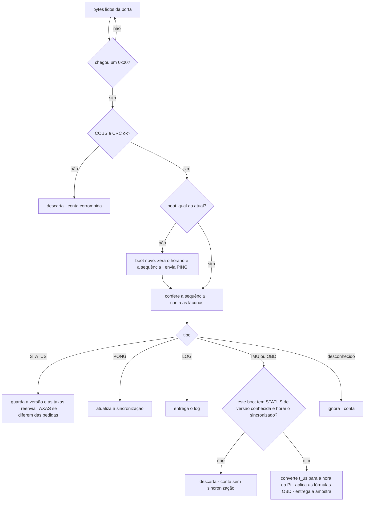
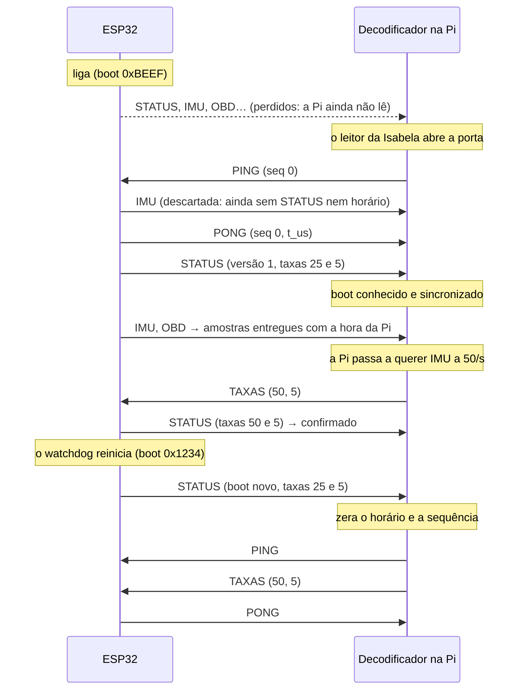

# Protocolo ESP32 ↔ Raspberry Pi

Como o ESP32 e a Pi conversam pelo cabo: o formato de cada mensagem e o que cada lado faz com ela. Especificação fechada no [ticket #7](https://github.com/V-guard-org/firmware_telemetria/issues/7) em 14/10/2026.

As decisões por trás deste documento estão nas ADRs:
- [ADR-0002](adr/0002-mensagens-binarias-com-crc-sem-confirmacao.md): mensagens binárias com CRC, sem reenvio das amostras.
- [ADR-0004](adr/0004-horario-pelo-relogio-do-esp32-convertido-na-pi.md): horário pelo relógio do ESP32, convertido na Pi.
- [ADR-0006](adr/0006-formulas-obd-no-decodificador.md): as fórmulas do OBD ficam no decodificador.

Os termos seguem o [`CONTEXT.md`](../CONTEXT.md).

## Resumo

- O ESP32 transmite desde o boot, sem esperar a Pi. Se ninguém está lendo, as mensagens se perdem, e isso é o esperado (D11).
- Cada mensagem é COBS com CRC-16 e um cabeçalho de 5 bytes: tipo, `boot` e sequência.
- Existem 7 tipos de mensagem, mais 1 de desenvolvimento, que sai junto com a simulação:

| Código | Nome | Sentido | Quando |
|---|---|---|---|
| `0x01` | STATUS | ESP32 → Pi | No boot e depois 1 vez por segundo |
| `0x02` | IMU | ESP32 → Pi | Na taxa de envio da IMU (padrão 25/s) |
| `0x03` | OBD | ESP32 → Pi | Na taxa de envio do OBD (padrão 5/s), enquanto o carro responde |
| `0x04` | PONG | ESP32 → Pi | Em resposta a cada PING |
| `0x05` | LOG | ESP32 → Pi | Quando o firmware registra um aviso ou um erro |
| `0x81` | PING | Pi → ESP32 | 1 vez por segundo, e logo que a Pi percebe um boot novo |
| `0x82` | TAXAS | Pi → ESP32 | Quando o STATUS mostra taxas diferentes das que a Pi quer |
| `0x83` | IMU_SIM | Simulador do PC → ESP32 | Só no desenvolvimento, 100 vezes por segundo (§4.3) |

- Os códigos de `0x00` a `0x7F` vão do ESP32 para a Pi, e os de `0x80` a `0xFF`, da Pi para o ESP32.
- Não há HELLO nem ACK:
  - o STATUS faz o papel do HELLO, porque também sai no boot;
  - o STATUS faz o papel do ACK, porque mostra a configuração em uso (§6.4).
- O decodificador Python aplica as fórmulas do OBD, converte o horário e só entrega amostras com horário confiável.

## 1. Ligação física

| Fase | Ligação | Velocidade |
|---|---|---|
| 1 · notebook | Par de pseudo-terminais (pty) entre o firmware nativo e o decodificador | Não se aplica |
| 2 · ESP32 na bancada | Cabo USB do DevKit (UART0 do ESP32) até o notebook | 460800 baud |
| 4 · integração | Fios TX, RX, GND e 5 V até a UART5 da Pi (`/dev/ttyAMA5`, pinos 32/33) | 460800 baud |

- Formato 8N1, sem controle de fluxo.
- No boot, a ROM do ESP32 imprime texto a 115200 baud na UART0. Na velocidade do protocolo, isso chega como lixo, e o CRC descarta.
- Qual UART do ESP32 vai para os fios na fase 4 fica para o ticket da fiação; para o protocolo, é só uma constante.

## 2. Moldura

```
COBS( cabeçalho | corpo | CRC16 ) 0x00
```

- **COBS** (*Consistent Overhead Byte Stuffing*) recodifica a mensagem para que o byte `0x00` nunca apareça dentro dela. Assim o `0x00` marca o fim de cada mensagem. Depois de lixo na linha, ou de abrir a porta no meio de uma mensagem, o decodificador se realinha no próximo `0x00`.
- **Tamanho:** cabeçalho + corpo + CRC ocupam no máximo 255 bytes. Depois do COBS são no máximo 257, mais o `0x00`. Se o decodificador acumular mais de 258 bytes sem encontrar um `0x00`, ele descarta tudo e conta uma mensagem corrompida.
- **CRC-16/CCITT-FALSE**, calculado sobre o cabeçalho e o corpo:
  - polinômio `0x1021`, valor inicial `0xFFFF`, sem reflexão e sem XOR final;
  - em Python: `binascii.crc_hqx(dados, 0xFFFF)`; para `b"123456789"` o resultado é `0x29B1`;
  - gravado em little-endian, como todos os números do protocolo.
- **Tipos numéricos:** `u8`, `u16`, `u32` e `u64` sem sinal, e `i16` com sinal, todos em little-endian.
- **Mensagem rejeitada:** COBS inválido, menos de 7 bytes depois do COBS, ou CRC errado. Ela é descartada e contada.

### 2.1 Cabeçalho (5 bytes)

| Offset | Campo | Tipo | Descrição |
|---|---|---|---|
| 0 | `tipo` | u8 | Código da mensagem (tabela do resumo) |
| 1 | `boot` | u16 | Sorteado pelo ESP32 a cada boot, de 1 a 65535. Nas mensagens da Pi vale 0, e o ESP32 o ignora. |
| 3 | `seq` | u16 | Contador de mensagens, independente em cada sentido |

- **Para que serve o `boot`:** o relógio do ESP32 recomeça do zero a cada boot. Com o `boot` em toda mensagem, o decodificador nunca converte o horário de um boot com a sincronização de outro.
- **Como `seq` conta:**
  - começa em 0 no boot do ESP32 (ou quando o decodificador é criado, no sentido da Pi);
  - soma 1 a cada mensagem transmitida, de qualquer tipo, e volta a 0 depois de 65535.
- **Quando `seq` é atribuído:** na hora de transmitir. Uma mensagem descartada dentro do ESP32, por fila cheia, não gasta número; ela aparece no contador do STATUS. Assim, cada lacuna de `seq` que a Pi vê é uma perda no cabo.

## 3. Mensagens do ESP32 para a Pi

Os campos `t_us` são os microssegundos desde o boot do ESP32 (`esp_timer_get_time()`).

### 3.1 STATUS (`0x01`)

Sai logo no boot, antes de qualquer amostra, e depois a cada 1 s.

| Offset | Campo | Tipo | Descrição |
|---|---|---|---|
| 0 | `versao` | u8 | Versão do protocolo; este documento é a versão **1**. É sempre o 1º byte, para que qualquer decodificador consiga lê-la. |
| 1 | `t_us` | u64 | Instante do STATUS, que é também o tempo ligado |
| 9 | `plataforma` | u8 | 0 notebook · 1 ESP32 |
| 10 | `fontes` | u8 | Bit 0: IMU simulada. Os demais bits valem 0. |
| 11 | `reinicio` | u8 | Motivo do último reinício (tabela abaixo) |
| 12 | `taxa_imu` | u8 | Taxa de envio da IMU em uso, em amostras/s |
| 13 | `taxa_obd` | u8 | Taxa de envio do OBD em uso, em amostras/s |
| 14 | `estado_imu` | u8 | 0 ok · 1 falha |
| 15 | `estado_obd` | u8 | 0 ESPERANDO_PI · 1 ESCUTANDO · 2 DESCOBRINDO · 3 LENDO · 4 SEM_RESPOSTA · 5 VELOCIDADE_ERRADA · 6 LINHA_PRESA · 7 FALHA_CAN · 8 BLOQUEADO ([`MAQUINAS-DE-ESTADO.md`](MAQUINAS-DE-ESTADO.md) §2) |
| 16 | `pids` | 12 bytes | Respostas do carro aos PIDs `0x00`, `0x20` e `0x40` (4 bytes cada, na ordem em que o carro os envia), unidas (OU) entre todas as centrais que responderam. Ficam zeradas até a descoberta. No 1º byte, o bit 7 é o PID `0x01`. |
| 28 | `contadores` | 9 × u32 | Somas desde o boot (tabela abaixo) |
| 64 | `heap_min` | u32 | Menor memória livre já registrada, em bytes |
| 68 | `firmware` | texto ASCII | Versão do firmware, por exemplo `0.4.0-a58af37`, com até 32 bytes. Ocupa o restante da mensagem. |

O corpo tem de 68 a 100 bytes, e a mensagem inteira, no máximo 107. O texto do firmware fica no fim para que todos os outros campos tenham posição fixa.

**Motivo do último reinício.** Os códigos são do protocolo, não do ESP-IDF, para não mudarem com uma versão nova do ESP-IDF e para funcionarem também no notebook:

| Código | Motivo | `esp_reset_reason()` |
|---|---|---|
| 0 | Desconhecido | Os demais |
| 1 | Energia (ligou) | `ESP_RST_POWERON` |
| 2 | Pino externo | `ESP_RST_EXT`. Não ocorre no ESP32 clássico, em que o botão EN aparece como 1. |
| 3 | Software | `ESP_RST_SW` |
| 4 | Pane | `ESP_RST_PANIC` |
| 5 | Watchdog | `ESP_RST_INT_WDT`, `ESP_RST_TASK_WDT` e `ESP_RST_WDT` |
| 6 | Queda de tensão | `ESP_RST_BROWNOUT` |

**Contadores**, em ordem. Nenhum zera, e a Pi calcula a diferença entre dois STATUS, então perder um STATUS não perde informação.

| # | Contador | O que conta |
|---|---|---|
| 0 | `descartadas` | Mensagens descartadas no ESP32 com a fila de saída cheia, LOGs acima do limite incluídos |
| 1 | `rejeitadas` | Mensagens da Pi com CRC errado, tipo desconhecido ou valor fora da lista |
| 2 | `falhas_imu` | Leituras da IMU que falharam |
| 3 | `obd_enviadas` | Requisições OBD transmitidas no CAN |
| 4 | `obd_respondidas` | Requisições que receberam resposta |
| 5 | `obd_sem_resposta` | Requisições que esgotaram o prazo |
| 6 | `bloqueadas` | Quadros barrados pela lista fechada. **Deve ser sempre 0**: é a prova de segurança da D2. |
| 7 | `erros_can` | Erros registrados pelo controlador CAN |
| 8 | `bus_off` | Entradas em *bus-off* |

### 3.2 IMU (`0x02`)

| Offset | Campo | Tipo | Unidade |
|---|---|---|---|
| 0 | `t_us` | u64 | µs desde o boot |
| 8 | `ax`, `ay`, `az` (média) | 3 × i16 | 0,01 m/s² |
| 14 | `gx`, `gy`, `gz` (média) | 3 × i16 | 0,1 °/s |
| 20 | `ax`, `ay`, `az` (pico) | 3 × i16 | 0,01 m/s² |
| 26 | `gx`, `gy`, `gz` (pico) | 3 × i16 | 0,1 °/s |

O corpo tem 32 bytes, e a mensagem inteira, 39. A faixa vai até ±327 m/s² e ±3276 °/s; valores além dela ficam travados em ±32767.

O que cada amostra significa:
- **Intervalo.** A IMU é lida 100 vezes por segundo. Cada amostra resume `100 / taxa` leituras: 4 leituras a 25/s, e 1 leitura a 100/s, quando a média e o pico são a própria leitura.
- **Média e pico.** A média é a de cada eixo. O pico é a leitura de maior módulo de cada eixo, mantendo o sinal. Exemplos:
  - um buraco, com `az` = 9,8 · 25,1 · 9,6 · 9,8, dá média de 13,6 e pico de 25,1;
  - uma frenagem, com `ax` = −6,0 · −6,2 · −5,9 · −6,1, dá média de −6,05 e pico de −6,2.
- **Eixos.** Ficam no referencial do carro (ISO 8855): x para a frente, y para a esquerda e z para cima. A rotação é positiva pela regra da mão direita. O ESP32 converte do referencial do sensor; até a mecânica definir a orientação da caixa (T11), essa conversão é a identidade.
- **Gravidade.** Fica incluída: com o carro parado e nivelado, `az ≈ +9,81`.
- **Horário.** `t_us` é a média dos instantes das leituras válidas, ou seja, o meio do intervalo. Carimbar na última leitura poria a média 15 ms atrasada a 25/s.
- **Falhas.** A amostra é calculada com as leituras válidas do intervalo. Se todas falharem, não sai amostra. Cada falha é somada em `falhas_imu`.

### 3.3 OBD (`0x03`)

| Offset | Campo | Tipo | Descrição |
|---|---|---|---|
| 0 | `t_us` | u64 | Instante em que a amostra foi montada |
| 8 | `n` | u8 | Quantidade de valores |
| 9 | valores | n × (abaixo) | Em ordem crescente de PID |

Cada valor:

| Campo | Tipo | Descrição |
|---|---|---|
| `pid` | u8 | PID do modo 01 |
| `idade` | u16 | Milissegundos entre a resposta do carro e `t_us`, travando em 65535 |
| `tam` | u8 | Número de bytes crus, de 1 a 4 |
| bytes crus | `tam` bytes | Os bytes de dados da resposta (A, B, …), sem o modo e sem o PID |

O que cada amostra significa:
- **Completa.** Traz todos os PIDs da lista da D6 que o carro respondeu desde que começou a responder. Ela nunca é um valor isolado, porque o `update()` da Pi substitui a amostra inteira.
- **PID não suportado** fica ausente, nunca nulo.
- **PID que parou de responder** continua na amostra, com a idade crescendo. A Pi descarta pela idade.
- **Bytes crus.** O ESP32 não aplica fórmulas; o decodificador aplica, com a tabela abaixo (ADR-0006). O `tam` permite ao decodificador pular um PID que ele não conhece.
- **Carro sem resposta** (ignição desligada; estado SEM_RESPOSTA, depois de 2 s sem nenhuma resposta): o ESP32 não envia amostras OBD, e os valores guardados são esquecidos. As amostras voltam sozinhas quando o carro responder de novo, já sem os valores antigos. O STATUS mostra o estado.

**Fórmulas aplicadas pelo decodificador.** Os nomes no dicionário entregue à Pi são definidos no ticket #12.

| PID | Valor | Fórmula | Unidade |
|---|---|---|---|
| `0x04` | Carga do motor | A·100/255 | % |
| `0x05` | Temperatura do líquido de arrefecimento | A − 40 | °C |
| `0x0B` | Pressão no coletor (MAP) | A | kPa |
| `0x0C` | Rotação | (256A + B)/4 | rpm |
| `0x0D` | Velocidade | A | km/h |
| `0x0F` | Temperatura do ar de admissão | A − 40 | °C |
| `0x11` | Posição do acelerador | A·100/255 | % |
| `0x42` | Tensão do módulo de controle | (256A + B)/1000 | V |

### 3.4 PONG (`0x04`)

| Offset | Campo | Tipo | Descrição |
|---|---|---|---|
| 0 | `seq_ping` | u16 | `seq` do PING respondido |
| 2 | `t_us` | u64 | Instante em que o PING chegou inteiro ao ESP32 |

O PONG passa na frente de tudo na fila de saída (§6.5).

### 3.5 LOG (`0x05`)

| Offset | Campo | Tipo | Descrição |
|---|---|---|---|
| 0 | `t_us` | u64 | Instante do registro |
| 8 | `nivel` | u8 | 1 erro · 2 aviso |
| 9 | `texto` | UTF-8 | Até 200 bytes, cortado se for maior; ocupa o restante da mensagem |

- Só os avisos e os erros do ESP-IDF e do firmware viram LOG.
- O limite é de 10 por segundo; o excesso é descartado e entra em `descartadas`.
- No notebook (fase 1), os logs também saem no terminal.

## 4. Mensagens da Pi para o ESP32

### 4.1 PING (`0x81`)

O corpo é vazio: o `seq` do cabeçalho serve de identificador, e o ESP32 o devolve no PONG.

### 4.2 TAXAS (`0x82`)

| Offset | Campo | Tipo | Valores aceitos | Padrão |
|---|---|---|---|---|
| 0 | `imu` | u8 | 100, 50, 25, 20 ou 10 amostras/s | 25 |
| 1 | `obd` | u8 | 1, 2, 5 ou 10 amostras/s | 5 |

- Cada campo vale sozinho: um valor fora da lista deixa aquele campo como estava e soma 1 em `rejeitadas`.
- A taxa nova vale a partir da próxima leitura da IMU, ou da próxima amostra OBD.
- A configuração não fica gravada no ESP32: depois de um reinício, ele volta ao padrão até a Pi reenviar (§6.4).
- O STATUS tem taxa fixa de 1/s.

### 4.3 IMU_SIM (`0x83`), só no desenvolvimento

Leva os valores da IMU simulada, do simulador do PC para o firmware ([`PLATAFORMA.md` §5](PLATAFORMA.md)). A Pi nunca envia esta mensagem, e ela não faz parte da API do decodificador para o leitor da Isabela (#12).

| Offset | Campo | Tipo | Unidade |
|---|---|---|---|
| 0 | `ax`, `ay`, `az` | 3 × i16 | 0,01 m/s² |
| 6 | `gx`, `gy`, `gz` | 3 × i16 | 0,1 °/s |
| 12 | `falha` | u8 | 0 normal · 1 a leitura falha |

O corpo tem 13 bytes, a mensagem inteira 20, e no cabo são 22.

- **Valores.** São uma leitura no referencial do sensor. O ESP32 gira para o referencial do carro, como faz com a IMU real; até o T11, essa rotação é a identidade.
- **Ritmo.** O simulador envia 100 por segundo, uma por leitura. A IMU simulada devolve o último valor recebido a cada leitura.
- **Falhas.** Com `falha` = 1, ou sem nenhuma IMU_SIM há mais de 1 s, a leitura falha. Depois de 10 falhas seguidas, a IMU entra em FALHA ([`MAQUINAS-DE-ESTADO.md` §3](MAQUINAS-DE-ESTADO.md)).
- **Firmware sem IMU simulada.** A mensagem soma 1 em `rejeitadas`.
- **Quando a simulação for apagada** (ADR-0003), esta mensagem sai do protocolo junto com ela.
- **Conteúdo.** O que o simulador põe nela é decidido no ticket #9.

## 5. O decodificador, mensagem a mensagem



## 6. Comportamento

### 6.1 Ciclo de vida



### 6.2 Boot novo

Quando chega uma mensagem com `boot` diferente do atual, o decodificador:
1. zera a sincronização e a contagem de sequência;
2. envia um PING na hora;
3. só volta a entregar amostras depois de receber, desse boot, um STATUS com uma versão que ele conhece e uma sincronização válida.

As amostras recebidas antes disso são descartadas e contadas como "sem sincronização".

**Por que descartar, e não entregar com um horário aproximado:** o `gerenciador_eventos` poda o buffer a partir da amostra mais nova. Uma amostra carimbada no futuro esvaziaria os 10 s da janela do evento.

Se a versão do STATUS for desconhecida, o decodificador avisa "versão incompatível" e não entrega nenhuma amostra daquele boot. Esse é o caso de um firmware antigo no carro com um decodificador novo na Pi.

### 6.3 Sincronização do horário (ADR-0004)

1. O decodificador envia um PING por segundo e anota o relógio monotônico da Pi no envio (`t1`) e na chegada do PONG (`t2`).
2. Cada PONG dá um par de horários: o meio da ida e volta, `(t1 + t2)/2`, corresponde ao `t_us` do ESP32. O erro desse par é no máximo metade do tempo de ida e volta.
3. Só valem pares com ida e volta de até 20 ms, ou seja, erro de até 10 ms (D12).
4. Com os pares mais rápidos dos últimos minutos, o decodificador ajusta uma reta, `monotônico = a + b·t_us`. A reta corrige o deslocamento e também a deriva do cristal do ESP32. Com um único par, só o deslocamento é usado.
5. Na entrega, o horário monotônico vira hora real com `time.time() − time.monotonic()`, calculado naquele momento. Se o chrony corrigir a hora da Pi aos saltos quando o GPS pegar sinal, as amostras seguintes já saem certas.

O número de pares e o tamanho da janela são valores iniciais a calibrar na bancada (#12 e #13).

### 6.4 Taxas de envio (RF29)

- Quem decide as taxas é a Pi. O decodificador guarda as taxas pedidas e, a cada STATUS cujas taxas em uso sejam diferentes delas, envia um TAXAS, no máximo um por STATUS.
- Isso cobre três casos sem ACK e sem prazo de espera: o comando chegou, o comando se perdeu, ou o ESP32 reiniciou e voltou ao padrão.
- O decodificador recusa, já na Pi, uma taxa fora da lista. Por isso um valor inválido nunca fica sendo reenviado.

### 6.5 Fila de saída do ESP32

A ordem de saída é: PONG, depois STATUS, depois IMU e OBD na ordem em que foram geradas, e por último LOG. Com a fila cheia, sai primeiro o LOG mais antigo e depois a amostra mais antiga. Cada descarte soma em `descartadas`.

### 6.6 Onde cada perda aparece

| O que aconteceu | Quem percebe | Onde |
|---|---|---|
| Mensagem perdida no cabo | Decodificador | Lacuna de `seq` |
| Mensagem corrompida | Decodificador | Contador de corrompidas |
| Fila cheia no ESP32 | ESP32 | `descartadas` no STATUS |
| Comando da Pi rejeitado | ESP32 | `rejeitadas` no STATUS |
| Amostra sem sincronização ou de versão desconhecida | Decodificador | Contador de sem sincronização |
| Tipo desconhecido | Decodificador | Contador de desconhecidas |

Para o critério de "sem perda relevante" (D16), as amostras perdidas são as lacunas de `seq` somadas ao aumento de `descartadas`, divididas pelo total no ensaio.

## 7. Tráfego

| Mensagem | Bytes no cabo | Típico | Pior caso |
|---|---|---|---|
| IMU | 41 | 25/s → 1025 B/s | 100/s → 4100 B/s |
| OBD (8 PIDs) | 60 | 5/s → 300 B/s | 10/s → 600 B/s |
| STATUS | até 109 | 1/s → 109 B/s | 109 B/s |
| PONG | 19 | 1/s → 19 B/s | 19 B/s |
| LOG | até 218 | quase nunca | 10/s → 2180 B/s |
| **Total** | | **≈ 1,5 kB/s** | **≈ 7 kB/s** |

A 460800 baud cabem cerca de 46 kB/s, então mesmo o pior caso ocupa cerca de 15% da linha.

No sentido contrário, o PING ocupa 9 B/s. No desenvolvimento, a IMU_SIM soma cerca de 2,2 kB/s (100 × 22 bytes).

## 8. Exemplos byte a byte

Use estes exemplos como vetores de teste no firmware e no decodificador.

**IMU.** Boot `0xBEEF`, `seq` 1, `t_us` 1 500 000. Médias: ax −0,62, ay 0,10, az 9,81 m/s²; gx 0,5, gy −1,2, gz 12,3 °/s. Picos: ax −0,80, ay 0,25, az 10,40 m/s²; gx 1,1, gy −2,0, gz 15,0 °/s.

```
antes do COBS (39): 02 EF BE 01 00 60 E3 16 00 00 00 00 00 C2 FF 0A 00 D5 03 05 00 F4 FF 7B 00
                    B0 FF 19 00 10 04 0B 00 EC FF 96 00 C8 15
no cabo (41):       05 02 EF BE 01 04 60 E3 16 01 01 01 01 04 C2 FF 0A 04 D5 03 05 04 F4 FF 7B
                    04 B0 FF 19 04 10 04 0B 04 EC FF 96 03 C8 15 00
```

**OBD.** Boot `0xBEEF`, `seq` 2, `t_us` 1 520 000, com 2 valores:
- RPM: A=`1A`, B=`F8`, idade de 40 ms, o que dá 1726 rpm;
- velocidade: A=`3C`, idade de 120 ms, o que dá 60 km/h.

```
antes do COBS (27): 03 EF BE 02 00 80 31 17 00 00 00 00 00 02 0C 28 00 02 1A F8 0D 78 00 01 3C A4 0D
no cabo (29):       05 03 EF BE 02 04 80 31 17 01 01 01 01 04 02 0C 28 06 02 1A F8 0D 78 05 01 3C
                    A4 0D 00
```

**PING.** `seq` 7.

```
antes do COBS (7):  81 00 00 07 00 1A 00
no cabo (9):        02 81 01 02 07 02 1A 01 00
```

## 9. Fora deste documento

- **Ticket #12:** os dicionários entregues ao leitor da Isabela, os nomes dos campos e as funções do decodificador.
- **[`MAQUINAS-DE-ESTADO.md`](MAQUINAS-DE-ESTADO.md)** (ticket #8): quando o ESP32 pergunta ao carro, quando o carro conta como "sem resposta", e qual central responde a cada PID.
- **[`PLATAFORMA.md`](PLATAFORMA.md)** (ticket #10): onde o núcleo portátil monta, envia e recebe estas mensagens, e o que fica na camada de plataforma.
- **Ticket #13:** como provar tudo isto (testes, ensaio de 2 h).
- **Ticket da fiação:** qual UART do ESP32 vai para os fios na fase 4.
