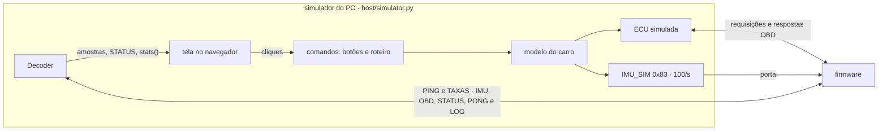

# Simulador do PC

O programa do notebook que faz o papel do carro e da Pi durante o desenvolvimento: define ao vivo o estado do carro e da IMU, roda roteiros e mostra o que chega do firmware. Especificação fechada no [ticket #9](https://github.com/V-guard-org/firmware_telemetria/issues/9) em 14/10/2026, a partir de um protótipo descartável (ramo `prototype/simulador`, arquivo `host/prototype/simulador.html`).

As decisões por trás deste documento estão nas ADRs:
- [ADR-0003](adr/0003-simulacao-ou-real-nunca-os-dois.md): simulação e fontes reais nunca convivem; o simulador fica no projeto, porque roda fora do dispositivo.
- [ADR-0005](adr/0005-codigo-testado-no-notebook-antes-das-placas.md): o código é testado no notebook antes de ir para as placas.
- [ADR-0009](adr/0009-imu-sim-pelo-usb-na-fase-4.md): na fase 4, a IMU simulada recebe a IMU_SIM pelo USB.

O que o firmware faz com cada mensagem está no [`PROTOCOLO.md`](PROTOCOLO.md), e o decodificador usado no papel da Pi, no [`DECODIFICADOR.md`](DECODIFICADOR.md). Os termos seguem o [`CONTEXT.md`](../CONTEXT.md).

## Resumo

- **Um programa, três papéis.** `host/simulator.py` faz o carro (o modelo do carro, a ECU simulada no CAN e a IMU_SIM na porta), a Pi (o `Decoder`, que envia o PING e o TAXAS) e a tela. Os três ficam no mesmo processo porque a porta do firmware só tem um leitor.
- **Modelo do carro ligado.** Quem usa mexe no motorista (acelerador, freio, volante e ignição). Velocidade, rotação, valores OBD e leituras da IMU saem do mesmo cálculo, coerentes entre si.
- **Tela no navegador,** servida pelo próprio programa em `http://localhost:8080`, só no notebook. Só a biblioteca padrão do Python 3.10+, no Linux.
- **Roteiros em texto:** uma ação por linha, com os mesmos comandos dos botões.
- **Sem tela,** o mesmo programa roda o ensaio de 2 h e imprime o critério da D16 ([`TESTES.md` §6](TESTES.md)).
- **Roteiros que se conferem:** o comando `confere` compara o que chegou com o esperado, e o modo sem tela termina com erro se algo falhar (emenda do #13).
- **Sem botões de falha do CAN.** Esses casos se provam nos testes e na bancada (§9).
- **Não é o dashboard do produto.** O simulador não manda nada ao servidor; o dashboard é do backend, fora deste mapa.

## 1. Visão geral



A IMU_SIM e o decodificador escrevem na mesma porta: um único descritor, aberto pelo simulador.

| Fase | Firmware | CAN da ECU simulada | Porta | Papéis do simulador |
|---|---|---|---|---|
| 1 · notebook | Nativo, iniciado pelo simulador | `vcan0` | `/tmp/vguard-esp32` | Carro, Pi e tela |
| 2 · bancada | ESP32 | `can0`, pelo adaptador USB-CAN com `slcand` ([#3](https://github.com/V-guard-org/firmware_telemetria/issues/3)) | `/dev/vguard-esp32` ([`BANCADA.md` §5](BANCADA.md)) | Carro, Pi e tela |
| 4 · integração, com a IMU simulada | ESP32, ligado à Pi pelos fios | `can0` | `/dev/vguard-esp32`, o USB, só com a IMU_SIM (ADR-0009) | Só o carro e a tela; a Pi de verdade faz o resto |

## 2. O laço

Uma thread faz `select()` na porta e no socket CAN, com prazo até o próximo tique de 10 ms, como o firmware nativo ([ADR-0008](adr/0008-nucleo-passivo-chamado-pela-plataforma.md)). A cada tique:
1. executa as ações do roteiro que venceram e os cliques que chegaram da tela;
2. avança o modelo do carro em 10 ms;
3. escreve uma IMU_SIM, a menos que "Parar a 0x83" esteja ligado;
4. passa ao `feed()` os bytes lidos da porta e escreve logo o que o `data_to_send()` devolve ([`DECODIFICADOR.md` §2.2](DECODIFICADOR.md)).

*Emenda do #20 (15/10/2026).* Os bytes que chegam entre dois tiques vão ao `feed()` na hora, e o `data_to_send()` sai logo depois. Assim, a chegada do PONG é o instante da leitura, e não o tique seguinte, que somaria até 10 ms à ida e volta. No tique, a ordem continua a de cima.

A ECU simulada não espera o tique: cada requisição lida do socket ganha uma resposta marcada para daqui a "atraso da resposta", e o `select()` acorda nesse prazo.

*Emenda da spec da fase 1 (15/10/2026).* A ECU simulada não abre o socket, como o `Decoder` não abre a porta. Ela recebe um quadro de requisição e o instante, e devolve os quadros de resposta, cada um com o instante em que deve sair. Quem lê e escreve no socket é este laço. Assim, a mesma ECU serve no `vcan0` e no `can0`, e os testes dela rodam sem o `vcan0`, que pede sudo ([`TESTES.md` §3.2](TESTES.md)).

O servidor da tela roda em outra thread. Ele só lê um retrato do estado e põe os cliques numa fila; quem mexe no modelo é sempre a thread do laço.

## 3. Modelo do carro

### 3.1 Motorista e carro

| Entrada | Faixa | Efeito |
|---|---|---|
| Acelerador | 0 a 100% | Até 4 m/s² de aceleração, menos o arrasto, que cresce com a velocidade |
| Freio | 0 a 100% | Até 9 m/s² de desaceleração |
| Volante | −100% (direita) a +100% (esquerda) | Intensidade da curva: 100% dá 6 m/s² de aceleração lateral. Devagar, vale a geometria do carro (entre-eixos de 2,6 m), e parado ele não gira. |
| Ignição | ligada ou desligada | Desligada: motor parado e centrais mudas |
| Partida | botão | Centrais mudas por 0,5 s e rotação de 250 rpm por 1 s, depois marcha lenta. Só com a ignição ligada. |

Com o acelerador solto, o motor freia um pouco (0,3 m/s²). A rotação segue 6 marchas automáticas, com 800 rpm em marcha lenta.

### 3.2 Valores OBD

| PID | Valor no modelo |
|---|---|
| `load` | 18 + 70 × acelerador, em %, com o motor ligado; 0 com ele parado |
| `coolant` | Sobe até 90 °C com o motor ligado; esfria até 25 °C com ele parado |
| `map` | 30 + 65 × acelerador, em kPa; 95 com o motor parado |
| `rpm` | Pela marcha e pela velocidade; 800 em marcha lenta; 250 na partida |
| `speed` | A velocidade do modelo |
| `iat` | 31 °C |
| `throttle` | 14 + 80 × acelerador, em % |
| `voltage` | 14,1 V com o motor ligado; 12,4 V só com a ignição |

A ECU simulada transforma cada valor nos bytes crus com as fórmulas inversas às do [`PROTOCOLO.md` §3.3](PROTOCOLO.md). Elas ficam escritas à parte, sem importar o decodificador: assim, um erro de fórmula de um dos lados aparece na tela, como diferença entre a linha do modelo e os pontos recebidos (ADR-0006).

### 3.3 Leituras da IMU

Todas no referencial do carro: x para a frente, y para a esquerda e z para cima ([`PROTOCOLO.md` §3.2](PROTOCOLO.md)).

| Eixo | Origem |
|---|---|
| `ax` | A aceleração longitudinal do modelo |
| `ay` | velocidade × giro |
| `az` | 9,81 m/s², mais as manobras de pista (§3.4) |
| `gx`, `gy` | A rolagem e a arfagem da carroceria: a rolagem acompanha a aceleração lateral, e a arfagem, a longitudinal (o carro "mergulha" ao frear) |
| `gz` | O giro do modelo, em °/s |

- **Ruído,** ligado por padrão: desvio de 0,05 m/s² e 0,3 °/s em cada eixo, mais a vibração do motor em `az` (0,12 m/s², no dobro da frequência de rotação).
- **Referencial do sensor.** Até o T11, é igual ao do carro. Quando o T11 definir a rotação da caixa, o simulador aplica a rotação inversa antes de enviar, e o firmware, ao girar a leitura, volta ao referencial do carro.

### 3.4 Manobras

Uma manobra é uma ação curta que o simulador aplica ao carro. Na tela do protótipo, elas se chamavam "eventos de direção"; o nome mudou porque "evento" é da Pi ([`CONTEXT.md`](../CONTEXT.md)).

| Manobra | O que faz | Duração |
|---|---|---|
| Buraco | Em `az`, uma queda, um pico e a volta, primeiro no eixo dianteiro e depois no traseiro, com 70% da força; `gy` acompanha. Cresce com a velocidade, até cerca de 25 m/s² em `az`, como o exemplo do [`PROTOCOLO.md` §3.2](PROTOCOLO.md). | Cerca de 0,1 s por eixo |
| Lombada | Em `az`, subida de cerca de 3,5 m/s² e descida; `gy` de ±14 °/s | Cerca de 0,5 s por eixo |
| Frenagem brusca | Freio a 90% e acelerador solto | 1,6 s |
| Curva à esquerda ou à direita | Volante a ±60%, cerca de 3,6 m/s² de aceleração lateral, com entrada e saída suaves | 4 s |
| Troca de faixa | Volante numa senoide de ±30%, cerca de ±1,8 m/s² | 3 s |

Durante a frenagem, a curva e a troca de faixa, a manobra assume o pedal ou o volante; ao fim, valem de novo os controles. Os valores são iniciais e ficam em constantes no topo do `car_model.py`.

## 4. Controles

A tela segue a variante A do protótipo: controles à esquerda, gráficos no meio e uma coluna à direita.

| Grupo | Controle | O que faz |
|---|---|---|
| Motorista | Acelerador, freio e volante; "Soltar tudo" | §3.1 |
| Manobras | Buraco, lombada, frenagem brusca, curva à esquerda, curva à direita, troca de faixa | §3.4 |
| Carro e centrais | Ignição; dar partida | §3.1 |
| | Atraso da resposta, de 0 a 80 ms (padrão 15 ms, com ±4 ms de variação) | Acima de 50 ms, a resposta chega depois do prazo do firmware |
| | Respostas perdidas, de 0 a 50% | A central deixa de responder a essa fração das requisições |
| | Cada PID: normal, ausente ou mudo | **Ausente:** a central não o anuncia; vale na próxima descoberta e, até lá, não responde. **Mudo:** anuncia, mas não responde, e sai da agenda depois de 5 faltas ([`MAQUINAS-DE-ESTADO.md` §2.4](MAQUINAS-DE-ESTADO.md)). |
| IMU simulada | Leitura com falha | Liga a marca de falha da IMU_SIM |
| | Parar a 0x83 | Para de enviar; depois de 1 s, as leituras falham |
| | Ruído | §3.3 |
| Pi | Manda PING | Desligado, o decodificador continua lendo, mas não envia PING; depois de 3 s, o firmware considera a Pi ausente |
| | Pi travada | O decodificador não lê nem escreve. Na fase 1, o pty enche, e o firmware descarta mensagens (`descartadas`) |
| | Taxas de envio da IMU e do OBD | As listas do [`PROTOCOLO.md` §4.2](PROTOCOLO.md), pelo `set_rates()` |
| | Reiniciar o ESP32 | Fase 1: encerra e reinicia o firmware nativo, que o simulador iniciou como processo filho. Fase 2: um pulso no RTS da porta, com o DTR solto, que o circuito de reinício da DevKit leva ao EN (conferido na bancada, [`TESTES.md` §10.3](TESTES.md)). Nos dois casos, sai um boot novo. |
| Roteiro | Escolher, rodar e parar | §6 |

Os botões continuam valendo com um roteiro rodando. "Parar" cancela as ações que faltam, e o carro fica como estava.

## 5. Tela

O `simulator.py` serve a página e mais duas rotas, só em `127.0.0.1`, para que nada fique exposto na rede:
- **`GET /state?desde=<t>`:** a página pergunta 10 vezes por segundo e recebe só os pontos novos desde `t`;
- **`POST /action`:** cada clique, com o mesmo comando de texto de um roteiro, por exemplo `{"comando": "buraco"}`. Assim, a tela e os roteiros passam pelo mesmo interpretador.

A página não usa bibliotecas externas; os gráficos são desenhados em `<canvas>`, como no protótipo.

**O que aparece:**
- **Faixa de estado:** PING, estado do OBD, estado da IMU, taxas em uso (e as pedidas, enquanto o STATUS não as confirmar), motor e o roteiro em curso.
- **Gráficos dos últimos 30 s:**
  - velocidade e rotação: a linha é o modelo; os pontos, o que chegou pela amostra OBD;
  - `ax`, `az` e `gz`: a linha é a IMU_SIM enviada; os pontos, a média recebida; os triângulos, o pico;
  - a marca `{}` mostra cada amostra vazia.
- **Faixas de estado no tempo:** OBD e IMU, pelo STATUS, e o PING da Pi. Como o STATUS sai 1 vez por segundo, um estado curto, como DESCOBRINDO (cerca de 15 ms), quase nunca aparece.
- **Última amostra OBD,** como chega ao `update()`, com `age_ms`.
- **Contadores:** os do ESP32, pelo STATUS, e os do `stats()` do decodificador.
- **Registro:** as ações, as linhas do roteiro, o que o decodificador percebe (mudanças de estado no STATUS, amostra vazia, um PID que sumiu da amostra, TAXAS enviado e confirmado) e os LOGs do ESP32.
- **Com um roteiro rodando:** no topo, a linha do tempo do roteiro, com as ações e a posição atual (da variante B do protótipo).

A tela mostra só o que o simulador pode saber: o modelo, porque ele é o carro; o que ele enviou; e o que chegou pelo decodificador. O estado interno do firmware só aparece pelo STATUS e pelo LOG. Na fase 1, a saída do firmware nativo continua no terminal do simulador.

## 6. Roteiros

Um roteiro é um arquivo de texto em `host/roteiros/`, com uma ação por linha: o tempo desde o início, em `m:ss`, e um comando.

```
# Volta no bairro: trajeto urbano com as manobras
0:00 ignição liga
0:01 partida
0:04 acelerador 30%
0:16 curva esquerda
0:23 buraco
1:01 frenagem brusca
1:15 fim
```

- Os comandos são os mesmos botões da tela, em português, porque o roteiro é feito para a equipe ler e editar.
- `#` começa um comentário, no início ou no fim da linha. `fim` marca o fim; sem ele, o roteiro termina 5 s depois da última ação.
- Um roteiro com uma linha que o programa não entende não roda; a mensagem diz o número da linha.
- *Emenda do #20.* Também não roda, com o número da linha: um tempo menor que o da linha anterior, uma linha depois do `fim` e um valor fora da faixa. O acelerador e o freio vão de 0% a 100%, e o volante, de −100% a +100%, sempre com o `%`. Um roteiro sem nenhuma ação não roda.

| Comando | Exemplo |
|---|---|
| Ignição | `ignição liga`, `ignição desliga` |
| Partida | `partida` |
| Pedais e volante | `acelerador 30%`, `freio 50%`, `volante -20%` (+ esquerda, − direita), `solta tudo` |
| Manobras | `buraco`, `lombada`, `frenagem brusca`, `curva esquerda`, `curva direita`, `troca de faixa` |
| PIDs | `pid voltage normal`, `pid voltage ausente`, `pid voltage mudo` |
| Centrais | `atraso 30 ms`, `perda 10%` |
| IMU simulada | `imu falha liga`, `imu falha desliga`, `imu sem-sinal liga`, `imu sem-sinal desliga`, `ruído liga`, `ruído desliga` |
| Pi | `pi ping liga`, `pi ping desliga`, `pi trava`, `pi destrava`, `taxas imu 50 obd 5`, `reinicia esp32` |
| Conferência | `confere obd lendo`, `confere imu falha`, `confere pid voltage ausente`, `confere vazias obd 1`, `confere central speed 7E9`, `confere boots 1` |
| Fim | `fim` |

**Roteiros iniciais** (os textos estão no protótipo):

| Arquivo | Duração | O que mostra |
|---|---|---|
| `volta-no-bairro.txt` | 1:15 | Trajeto urbano até cerca de 50 km/h, com as seis manobras |
| `liga-e-desliga.txt` | 0:55 | Partida sem interrupção do OBD; ignição desligada, com SEM_RESPOSTA e `{}`; a volta do OBD |
| `falhas.txt` | 1:10 | PID mudo saindo da agenda; IMU em falha e sem sinal; Pi sem PING e travada; troca de taxas |
| `volta-no-maximo.txt` | 1:15 | A `volta-no-bairro.txt` com `0:00 taxas imu 100 obd 10`, para os 30 min nas taxas máximas do ensaio |

**Conferência (emenda do #13).** Um `confere` compara o que o simulador sabe naquele instante, pelo último STATUS, pelas amostras e pela ECU simulada, com o valor esperado. Um `confere` que falha vai para o registro, com o número da linha, e o roteiro continua. Os alvos, a folga de 2 s depois de uma mudança e um exemplo estão no [`TESTES.md` §4](TESTES.md). Os roteiros prontos ganham os seus `confere`.

## 7. Sem tela

```
python3 host/simulator.py --roteiro host/roteiros/volta-no-bairro.txt --repetir --sem-tela --duracao 2h
```

Sem a tela, o programa roda o roteiro e, ao fim, imprime um resumo, também como uma linha JSON, para o ensaio de 2 h ([`TESTES.md` §6](TESTES.md), D16):
- a duração e as amostras entregues (`imu`, `obd`);
- as perdidas: `lost` mais o aumento de `descartadas`, e a razão sobre o total, que deve ficar abaixo de 0,1% ([`PROTOCOLO.md` §6.6](PROTOCOLO.md));
- os boots vistos, que devem ser 1, ou seja, nenhum reinício;
- `fora_da_lista`: os quadros do ESP32 que a ECU simulada viu fora da lista fechada, que deve ser 0 ([`TESTES.md` §5](TESTES.md));
- `fora_do_esperado`: as amostras cujo conteúdo não bate com a IMU_SIM enviada ou com as respostas da ECU simulada, que deve ser 0 ([`TESTES.md` §6](TESTES.md));
- os `confere` que falharam;
- os demais contadores do `stats()` e do último STATUS.

O programa termina com código de saída 1 se algum `confere` ou algum critério falhou (emenda do #13).

*Emenda do #20 (15/10/2026):*
- **Saída.** O registro (as linhas do roteiro, o resultado de cada `confere`, as mudanças do STATUS, as amostras vazias e os LOGs do ESP32) sai na saída padrão, uma linha por fato, com o tempo do simulador. O resumo vem no fim, e a linha JSON é sempre a última. A saída do firmware nativo continua na saída de erro.
- **Códigos de saída.** 0 se tudo deu certo. 1 se algum `confere` falhou ou se a corrida quebrou: a porta fechou, ou o firmware terminou sozinho. 2 se nada rodou: uma opção errada, ou uma linha do roteiro que o programa não entende.
- **O firmware filho** roda numa sessão própria: um Ctrl+C para o simulador, e o simulador para o firmware. Para reiniciar, o simulador fecha a porta, manda SIGTERM ao firmware (SIGKILL depois de 2 s), apaga um atalho que tenha sobrado, inicia o firmware de novo, espera o atalho novo e reabre a porta. A porta é aberta com `TCSANOW`, e não com o `TCSAFLUSH` do `tty.setraw()`, para não perder o STATUS do boot.
- **Até a tela (#27),** o `--sem-tela` é obrigatório. Um roteiro com `reinicia esp32` pede `--firmware`, até existir o pulso no RTS da fase 2.
- **Até a IMU simulada (#21),** o firmware nativo soma cada IMU_SIM em `rejeitadas` ([`PROTOCOLO.md` §4.3](PROTOCOLO.md)), cerca de 100 por segundo.

Com `--gravar sessao.jsonl`, com ou sem tela, o programa grava uma linha por ação, por amostra entregue e por STATUS, e o estado do modelo 10 vezes por segundo.

## 8. Linha de comando

| Opção | Padrão | Função |
|---|---|---|
| `--porta CAMINHO` | `/tmp/vguard-esp32` | A porta do firmware; nas fases 2 e 4, `/dev/vguard-esp32` |
| `--can CANAL` | `vcan0` | O canal da ECU simulada; na fase 2, `can0` |
| `--firmware CAMINHO` | — | Fase 1: inicia o firmware nativo como processo filho, o que permite "Reiniciar o ESP32" |
| `--http-port N` | 8080 | A porta da tela, só em `127.0.0.1` |
| `--roteiro ARQUIVO` | — | Roda o roteiro ao iniciar |
| `--repetir` | não | Recomeça o roteiro ao terminar |
| `--sem-tela` | não | Sem servidor; imprime o resumo ao fim (§7) |
| `--duracao TEMPO` | — | Tempo total, como `2h`, `30min`, `90s` ou `1h30min`. Com um roteiro, a corrida acaba no que vier primeiro. |
| `--gravar ARQUIVO` | — | Grava a sessão em JSONL |
| `--duas-centrais` | não | Acrescenta uma 2ª central em `0x7E9` (abaixo) |
| `--so-carro` | não | Fase 4 (ADR-0009): não faz o papel da Pi; só envia a IMU_SIM e responde no CAN |
| `--semente N` | aleatória | Torna o ruído e as perdas repetíveis |

**Duas centrais.** Por padrão, uma única central, em `0x7E8`, tem os 8 PIDs. Com `--duas-centrais`:
- a `0x7E8` (motor) tem todos, menos `speed`;
- a `0x7E9` (câmbio) tem só `speed` e `rpm`.

O firmware deve perguntar `rpm` à `0x7E8`, a de menor endereço, e `speed` à `0x7E9`, pelo ID `0x7E1` ([`MAQUINAS-DE-ESTADO.md` §2.3](MAQUINAS-DE-ESTADO.md)).

## 9. Falhas do CAN

No notebook, o CAN é virtual (`vcan`): não tem ACK, disputa nem erros, então todo quadro "sai". O simulador não tem botões para fingir essas falhas (#9 Q8):
- a lógica de cada caso se prova nos testes, com a porta CAN falsa ([`PLATAFORMA.md` §6](PLATAFORMA.md));
- o hardware se prova na bancada da fase 2, com a falha feita à mão: desligar o adaptador do barramento para tirar o ACK, pôr o adaptador a 250 kbit/s para a velocidade errada, ligar a linha do barramento ao GND para a linha presa, o que é seguro: passam 3,3 mA pelo *pull-up*. O roteiro completo da bancada está no [`TESTES.md` §10.3](TESTES.md).

**Extensão possível,** se na fase 1 fizer falta ver ao vivo a reação inteira: botões que mandam a falha pela entrada do firmware nativo, que o simulador já inicia. A falha seria fingida só no adaptador CAN do notebook (`src/native/`), sem mudar o ESP32 nem o protocolo.

## 10. Arquivos

```
host/
  simulator.py          o simulador: laço, porta, CAN, servidor da tela e modo sem tela
  car_model.py          o modelo do carro (§3)
  ecu_sim.py            a ECU simulada: recebe requisições OBD e devolve as respostas, com as fórmulas inversas; não abre o socket (§2)
  simulator.html        a tela (a variante A do protótipo, refeita)
  roteiros/             volta-no-bairro.txt, liga-e-desliga.txt, falhas.txt, volta-no-maximo.txt
  test_ecu_sim.py       ida e volta das fórmulas de cada PID (unittest)
  test_roteiros.py      leitura dos roteiros (unittest)
  esp32_decoder.py      (#12) usado pelo simulador no papel da Pi
  fake_esp32.py         (#12) passa a tirar os valores do car_model.py
```

- Só a biblioteca padrão do Python 3.10+. O SocketCAN vem do `socket.AF_CAN`, e o pty, do `os`, então o simulador roda no Linux.
- O código e os nomes ficam em inglês (D18). Os roteiros e a tela ficam em português, porque são feitos para a equipe ler.
- O `fake_esp32.py` usa o mesmo modelo do carro, com o seu percurso de 60 s ([`DECODIFICADOR.md` §4](DECODIFICADOR.md)).
- **Permanência.** O simulador roda fora do dispositivo, então fica no projeto (ADR-0003). Quando a simulação for apagada, sai do firmware só a IMU simulada, com a IMU_SIM e a leitura da UART0 da fase 4 ([`PLATAFORMA.md` §5](PLATAFORMA.md)).

## 11. Fora deste documento

- **[`TESTES.md`](TESTES.md)** (ticket #13): o ensaio de 2 h com `--sem-tela`, o `confere`, o roteiro das falhas de CAN na bancada e a conferência do reinício pelo RTS.
- **[`BANCADA.md`](BANCADA.md)** (ticket #11): as três placas da bancada, os nomes fixos das portas e, na fase 4, os fios até a Pi pela UART2, com o fio de 5 V desligado enquanto o USB estiver ligado (ADR-0009).
- **Dashboard e servidor:** são do backend, fora do mapa do firmware. O simulador não manda nada a eles.
- **Rastreamento:** a posição vem do GPS, ligado na Pi (T16, Nicolas). O simulador não simula posição (#9 Q15).
