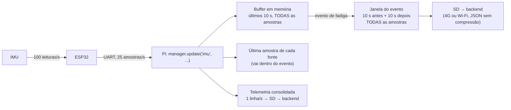

# Notas do firmware para a equipe

> **Arquivo congelado em 13/10/2026.** A versão compartilhada e atualizada é o documento "Firmware V-GUARD — decisões para aprovação" (https://claude.ai/code/artifact/d188906f-77cf-4ada-a2a3-29e620e97650). As decisões formais estão em `docs/adr/`, e os termos em `CONTEXT.md`.

Pontos que surgiram no planejamento do firmware (ESP32) e que afetam o trabalho de outros membros. Cada nota diz para quem é e em que pé está.

- **Decidido:** já vale; só para ciência e conferência.
- **Em discussão:** ainda não fechado; a opinião de quem está marcado é necessária.

As decisões com registro formal estão em `docs/adr/`, e os termos usados aqui estão em `CONTEXT.md`.

Última atualização: 13/10/2026.

---

## ⚠️ 1. MUITO IMPORTANTE: o ESP32 vai PERGUNTAR ao carro, não só escutar

**Para:** todos, em especial o Nicolas (T17) · **Decidido pela equipe do firmware, todos precisam saber** · ADR-0001

Cogitamos que o ESP32 nunca transmitisse nada no barramento CAN do carro, por segurança. **Isso inviabiliza a parte OBD do projeto**, pelos motivos abaixo.

- **O OBD-II funciona por pergunta e resposta.** Para saber o RPM, alguém envia ao carro a requisição "modo 01, PID 0x0C" e a central do motor responde. Sem perguntar, não há resposta, e os requisitos RF03, RF04 e RF05 (PIDs suportados, RPM, velocidade e demais parâmetros) ficam impossíveis.
- **Só escutando, depende do carro.** Em muitos carros o conector OBD fica **mudo** até alguém perguntar, porque há um gateway entre o conector e a rede interna. Nos que têm tráfego espontâneo, as mensagens são **proprietárias de cada montadora** e não documentadas, e interpretá-las é justamente o que o **AE04** deixa fora do escopo.
- **O Plano de Projeto já permite perguntar.** O AE02 e o RNF10 autorizam as "requisições padronizadas de diagnóstico OBD-II". É o que qualquer scanner de oficina, ou um adaptador Bluetooth ELM327 de R$ 30, faz em qualquer carro.

**Onde está o perigo de verdade, e como o firmware se protege:**

- O perigo não está em pedir RPM. Está em **outros serviços** do diagnóstico: apagar códigos de falha, escrever na memória da central, acionar atuadores.
- O firmware terá uma **lista fechada no código**: só passa uma requisição padronizada de leitura (modo 01) para os endereços padronizados. Qualquer outro quadro é bloqueado e contado, e um teste automático prova isso.
- O ESP32 **escuta antes de falar**, para não transmitir numa velocidade de barramento errada.
- Há **limite de requisições por segundo**, e o ESP32 para de perguntar quando o carro não responde (ignição desligada).
- **Para o Thiago:** um transceptor com pino de modo silencioso (no SN65HVD230 é o pino Rs; a confirmar no datasheet) pode impedir **no hardware** qualquer transmissão enquanto o firmware não liberar.

As medidas de segurança detalhadas estão sendo fechadas no planejamento.

## 2. Leituras da IMU que chegam à Pi, e o peso disso no 4G

**Para:** Isabela · **Decidido (25 amostras/s); uma pergunta para ela**

Como os dados da IMU percorrem o sistema, pelo código do `gerenciador_eventos`:



A telemetria consolidada é sempre de 1 linha por segundo. A taxa da IMU só pesa na **janela do evento**, que sobe **também pelo 4G**. Cada amostra de IMU ocupa cerca de 200 bytes no JSON, então só a IMU custa por evento: 100/s ≈ 400 kB · 50/s ≈ 200 kB · **25/s ≈ 100 kB** · 10/s ≈ 40 kB.

**Decisão:** o ESP32 lê a IMU 100 vezes por segundo e envia à Pi **25 amostras por segundo**. Cada amostra traz a **média** e o **pico** das 4 leituras do intervalo:
- A média descreve bem freadas e desvios, que duram de 0,5 a 3 s, e filtra a vibração do motor.
- O pico preserva impactos curtos, que sumiriam entre amostras espaçadas.

A taxa pode ser mudada pela Pi (RF29).

**Pergunta para a Isabela:** a janela precisa subir inteira pelo 4G, ou dá para reduzir a taxa dela só no envio por 4G (mandando a completa pelo Wi-Fi)?

## 3. A Pi guarda só a última amostra de cada fonte, inteira

**Para:** Isabela · **Decidido**

`manager.update("obd", {...})` **substitui** o dicionário anterior da fonte `obd`, em vez de misturar os dois. Se o ESP32 mandasse um valor por vez:

```
update("obd", {"rpm": 2100})     → última OBD = {rpm: 2100}
update("obd", {"coolant": 88})   → última OBD = {coolant: 88}   ← o rpm sumiu
record_event(...)                → o evento sai sem rpm
```

**Decisão:** o ESP32 envia sempre uma **amostra OBD completa**, com todos os valores disponíveis naquele instante. Assim a última amostra OBD na Pi está sempre completa, e nada muda no `gerenciador_eventos`. Como representar um valor velho ou um PID que o carro não tem ainda está em discussão.

## 4. Leitor da UART na Pi e formato das mensagens

**Para:** Isabela · **Decidido** · ADR-0002

O código da Pi que lê a UART e chama `manager.update(...)` fica com a Isabela.

O formato das mensagens no cabo é **binário com CRC**:
- Cada mensagem tem um código de verificação (CRC) e um número de sequência.
- Uma mensagem corrompida por ruído no cabo é descartada, nunca aceita como válida, e a sequência mostra quantas se perderam.
- É 3 a 4 vezes menor que JSON.

A equipe do firmware entrega para ela:
- Um **decodificador pronto em Python**, só com a biblioteca padrão, como o resto do `gerenciador_eventos`. Ela recebe dicionários prontos e não precisa mexer em bytes.
- O **horário de cada amostra já convertido** para o relógio da Pi (ver nota 6).
- A especificação do protocolo, gravações reais do fluxo para testes e o ESP32 com sensores simulados, para ela testar sem o hardware.
- **Um guia explicando tudo isso para ela**: como os dados chegam, como usar o decodificador e o que significa cada campo.

## 5. O que acontece quando a Pi não está lendo, ou uma mensagem se perde

**Para:** todos (para conferir) · **Decidido** · ADR-0002

- **As amostras não são reenviadas.** Se uma mensagem se perde ou chega corrompida, ela é descartada, e o número de sequência mostra à Pi quantas faltaram. Uma amostra atrasada tem pouco valor.
- **O ESP32 não guarda o que leu enquanto a Pi não escuta.** Exemplo: o carro liga, o ESP32 começa a ler em 1 s, mas a Pi leva cerca de 30 s para subir o programa. Essas amostras são descartadas: sem a Pi não há câmera nem evento, então elas não teriam uso.
- **Os comandos da Pi para o ESP32**, como mudar a taxa de envio, recebem confirmação.

## 6. Horário das amostras

**Para:** Isabela, Nicolas · **Decidido** · ADR-0004

- **Meta:** o intervalo entre amostras consecutivas é exato, porque vem do relógio do próprio ESP32, e o erro do horário absoluto fica em **no máximo 10 ms**.
- **Como:** o ESP32 não sabe a hora real. Periodicamente a Pi pergunta "minha hora é X", o ESP32 responde "a minha é Y", e a Pi calcula a diferença descontando o tempo de ida e volta. A conta fica **dentro do decodificador** que entregamos, então a Isabela já recebe o `ts` pronto.
- **Para o Nicolas:** para que o relógio da Pi seja o horário GPS, a Pi precisa do **chrony com o PPS do GPS** configurado (parte do T16).

## 7. Ligação física entre a Pi e o ESP32

**Para:** Thiago (T19), Nicolas · **Em discussão**

| | Cabo USB | 3 fios nos pinos (TX, RX, GND) |
|---|---|---|
| Alimentação do ESP32 | Vem da Pi pelo cabo | Precisa de fio de 5 V à parte |
| Quando o programa da Pi abre a porta | O ESP32 pode **reiniciar** (circuito de auto-reset da placa) | Nada acontece |
| No carro | O conector pode soltar com vibração | Soldado na placa perfurada |
| Regravar o firmware | A Pi consegue sozinha | Precisa de um notebook, ou de fios extras |
| Configuração na Pi | Nenhuma | Liberar uma UART da Pi 4 (`dtoverlay`) |

## 8. Simulação: um ou outro, nunca os dois

**Para:** todos · **Decidido** · ADR-0003

- **Para que serve:** a simulação (sensores simulados e o segundo ESP32 fazendo papel do carro) existe **só para desenvolver** enquanto não há hardware. Os dados simulados são gerados por nós (roteiros curtos de direção) e não vêm de carros reais.
- **Depois do ensaio no carro:**
  - **Se o real funcionar**, a simulação é **apagada**.
  - **Se não funcionar**, o projeto segue **só com a simulação**, inclusive na demonstração. Isso também cobre o risco R06 do Plano de Projeto (indisponibilidade do veículo).
- **Nunca há real e simulado no mesmo projeto.** Por isso o código simulado fica isolado e pode ser removido inteiro sem mexer no resto.

## 9. Critério de "sem perda relevante" na UART (T24.2)

**Para:** todos · **Decidido**

Num ensaio de **2 horas**, a comunicação ESP32 → Pi deve ter:
- **menos de 0,1%** de amostras perdidas;
- **nenhuma** mensagem corrompida aceita como válida;
- **nenhum** reinício do ESP32.
